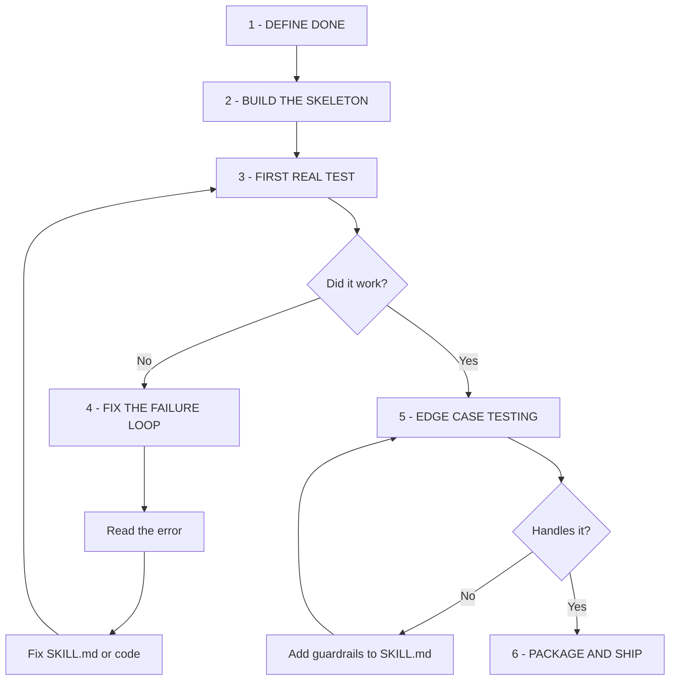

# How To Create A Skill

Building a great agent skill is an iterative loop, not a one-shot task. You start by clearly defining what "done" looks like, scaffold the skill files, then run a real test. From there, it's a cycle of reading errors, fixing your SKILL.md or code, and retesting until it works. Once the happy path is solid, you stress-test edge cases, add guardrails, and ship it.



---

## The 6-Phase Loop

### Phase 1: Define Done

Before writing a single line, answer:

1. **What does this skill produce?** -- A deployment? A report? A configured system?
2. **How do I know it worked?** -- Specific commands to verify success
3. **What could go wrong?** -- Top 3-5 failure modes

Write these as two sections in your SKILL.md:

- `## Define Done` -- A checklist of success criteria
- `## Quality Tests` -- Domain-specific, falsifiable tests with PASS/FAIL criteria

**Why first?** Without Define Done, you'll keep adding features instead of shipping. Without Quality Tests, you'll miss edge cases.

### Phase 2: Build the Skeleton

Choose your archetype and scaffold from a template:

| Archetype | Use When | Template | Has scripts/ | Has reference/ |
|-----------|----------|----------|-------------|----------------|
| CLI Orchestration | Chaining CLI commands into workflows | `CLI-WORKFLOW-TEMPLATE.md` | Often | Sometimes |
| Knowledge/Methodology | Teaching frameworks, patterns, decision criteria | `KNOWLEDGE-SKILL-TEMPLATE.md` | Rarely | Often |

**Minimum viable skill:**
```
my-skill/
  SKILL.md          # Frontmatter + body (from template)
```

**Mature skill (add as needed):**
```
my-skill/
  SKILL.md          # Core skill document
  scripts/          # Executable bash wrappers for common workflows
  reference/        # Detailed catalogs, templates, decision criteria
```

### Phase 3: First Real Test

Run the skill with a real agent workflow:

```
# Clear cache so the skill is discoverable
skill_discover({ clearCache: true })

# Verify it loads
skill_get({ name: "my-skill-name" })

# Test discovery with expected queries
skill_evaluate({ text: "description of when skill should activate" })
```

Then ask an agent to perform the task the skill teaches. Does it produce the right commands? Does the output match expectations?

### Phase 4: Fix the Failure Loop

When it doesn't work (and it won't the first time):

1. **Read the error** -- exact error message, not what you think went wrong
2. **Trace to the skill** -- which instruction produced the wrong command?
3. **Fix SKILL.md** -- add missing commands, fix routing, add error handling
4. **Retest** -- clear cache, re-evaluate, try again

Common first-iteration fixes:
- Commands that don't exist (verify with `--help`)
- Missing `--json` flags (agent can't parse plain text output)
- Wrong decision routing (condition table needs another row)
- Missing prerequisites (env var not documented)

### Phase 5: Edge Case Testing

Once the happy path works, test:

- **Missing config** -- what happens when env vars aren't set?
- **Service down** -- what if a service is unhealthy?
- **Wrong input** -- what if the user provides bad data?
- **Partial failure** -- what if step 3 of 5 fails?

For each edge case that breaks the skill, add:
- An error handling row to the Error Handling table
- A guardrail step or decision route to Instructions
- A quality test to the Quality Tests section

### Phase 6: Package and Ship

Final checklist before shipping:

- [ ] **Frontmatter optimized** -- name is 2-3 words, keywords include domain terms + synonyms
- [ ] **Discovery verified** -- `skill_evaluate` matches for 3+ phrasings of the intended use case
- [ ] **All commands verified** -- every CLI command shown actually exists
- [ ] **Error handling complete** -- maps to the error hierarchy with recovery commands
- [ ] **Cross-references set** -- related skills linked, not duplicated
- [ ] **Define Done present** -- checklist of what success looks like
- [ ] **Quality Tests present** -- domain-specific tests with PASS/FAIL
- [ ] **Steps marked** -- REQUIRED vs OPTIONAL clearly labeled

---

## Two Skill Archetypes

### CLI Orchestration Skills

Chain multiple CLI commands into business workflows. Examples: deploy-product, infrastructure-health, lead-pipeline.

**Characteristics:**
- Instructions are numbered steps with specific CLI commands
- Decision tables route to different commands based on conditions
- Error handling maps to the CLI's error hierarchy
- Often have `scripts/` with executable bash wrappers
- Use `--json` for machine-parseable output between steps

**Section order:** Overview -> Define Done -> Prerequisites -> Instructions -> Examples -> Error Handling -> Quality Tests -> Guidelines -> References

### Knowledge/Methodology Skills

Teach frameworks, mental models, or decision criteria. Examples: competitive-analysis, design-patterns, code-review.

**Characteristics:**
- Framework section teaches HOW to think about the domain
- Instructions apply the framework to inputs
- Examples show the framework applied to real scenarios
- Often have `reference/` with detailed catalogs or templates
- Output is an artifact (document, decision, analysis) not a CLI result

**Section order:** Overview -> Define Done -> Prerequisites -> Framework -> Instructions -> Examples -> Quality Tests -> Guidelines -> References

---

## When to Add scripts/

Add executable scripts when:
- The skill has a multi-step workflow users run frequently
- The workflow involves 3+ CLI commands in sequence
- Error handling and recovery should be automated

**Bash conventions:**
```bash
#!/usr/bin/env bash
set -euo pipefail

# Load environment
SCRIPT_DIR="$(cd "$(dirname "${BASH_SOURCE[0]}")" && pwd)"
if [[ -f "${SCRIPT_DIR}/../../../.env" ]]; then
    set -a; source "${SCRIPT_DIR}/../../../.env"; set +a
fi

# Required arguments with usage message
NAME="${1:?Usage: $0 <name>}"

# Progress to stderr, results to stdout
echo "Processing ${NAME}..." >&2

# ... commands ...

echo '{"status": "ok"}'  # JSON to stdout
```

**File extensions:**
- In `knowledge-copilot/`: use `.sh.md` (Obsidian compatibility)
- In `.claude/skills/`: use plain `.sh` (executable)

## When to Add reference/

Add reference materials when:
- SKILL.md would exceed 200 lines with all the detail
- Catalogs, templates, or checklists are reused across multiple contexts
- Decision criteria are complex enough to need their own document

| Goes in reference/ | Stays in SKILL.md |
|-------------------|-------------------|
| Full command inventories | Summary routing tables |
| Error catalogs with all variants | Top 5 common errors |
| Code templates and patterns | When to use each pattern |
| Per-type checklists (e.g., meeting types) | High-level decision flow |

---

## Frontmatter Optimization

The skills-copilot evaluation engine weights fields:

| Field | Weight | Tips |
|-------|--------|------|
| `name` | 0.40 | kebab-case, 2-3 words, action-oriented (deploy-product, not platform-helper) |
| `triggers.keywords` | 0.35 | Include tool names, service names, business terms, AND synonyms |
| `triggers.files` | 0.25 | File patterns that trigger this skill (for file-context skills) |
| `description` | 0.15 | 1-2 sentences: what it does + when to use it |

**Keyword strategy:**
- Technical terms the agent would search: "deploy", "release", "docker"
- Business terms the user would say: "ship", "release", "go live"
- Error terms that might trigger the skill: "unhealthy", "503", "connection refused"

---

## Quality Test Examples by Domain

| Domain | Test | What It Checks |
|--------|------|---------------|
| Deployment | Rollback Readiness | Previous deployment exists before deploying |
| Database | Backup Before DDL | Backup exists before ALTER/DROP |
| Intelligence | Source Diversity | Brief uses 3+ data sources |
| Onboarding | Cross-System Consistency | Same data across all systems |
| Troubleshooting | Root Cause | Fix addresses cause, not symptom |
| Automation | Idempotency | Re-running doesn't create duplicates |
| Routing | Command Accuracy | Every listed command actually exists |

---

## Required vs Optional Step Marking

Mark steps to help agents prioritize:

```markdown
### Step 1: Pre-checks (REQUIRED)
### Step 2: Execute (REQUIRED)
### Step 3: Verify (REQUIRED)
### Step 4: Enrich (OPTIONAL)
### Step 5: Notify (OPTIONAL)
```

**Rule of thumb:** If skipping the step would make the workflow fail or produce wrong results, it's REQUIRED. If skipping it means less detail but still a correct result, it's OPTIONAL.

---

## Common Mistakes

1. **Vague instructions** -- "deploy the app" instead of `deploy trigger --app-id "$APP_ID" --json`
2. **No error handling** -- "check logs" instead of mapping to specific error types with recovery commands
3. **Generic keywords** -- "manage", "handle" instead of domain-specific terms
4. **Missing Define Done** -- no way to know when the skill's workflow is complete
5. **Duplicated content** -- copying from other skills instead of cross-referencing
6. **All steps required** -- not marking optional enrichment steps, wasting agent effort

See the reference skills in this directory for mature examples:
- `ElevenLabs Audio Generator/` -- CLI Orchestration with scripts
- `Video Generator (Remotion)/` -- CLI Orchestration with scripts + reference
