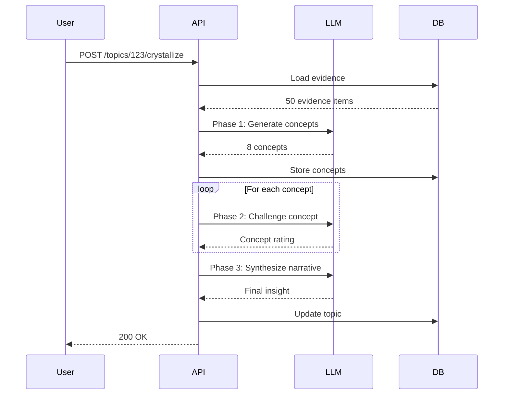
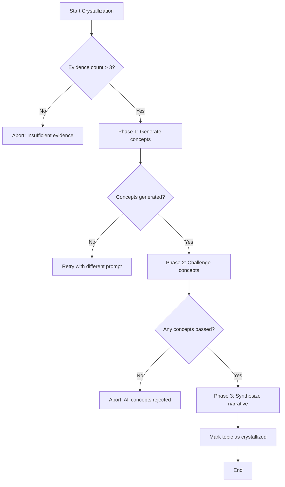
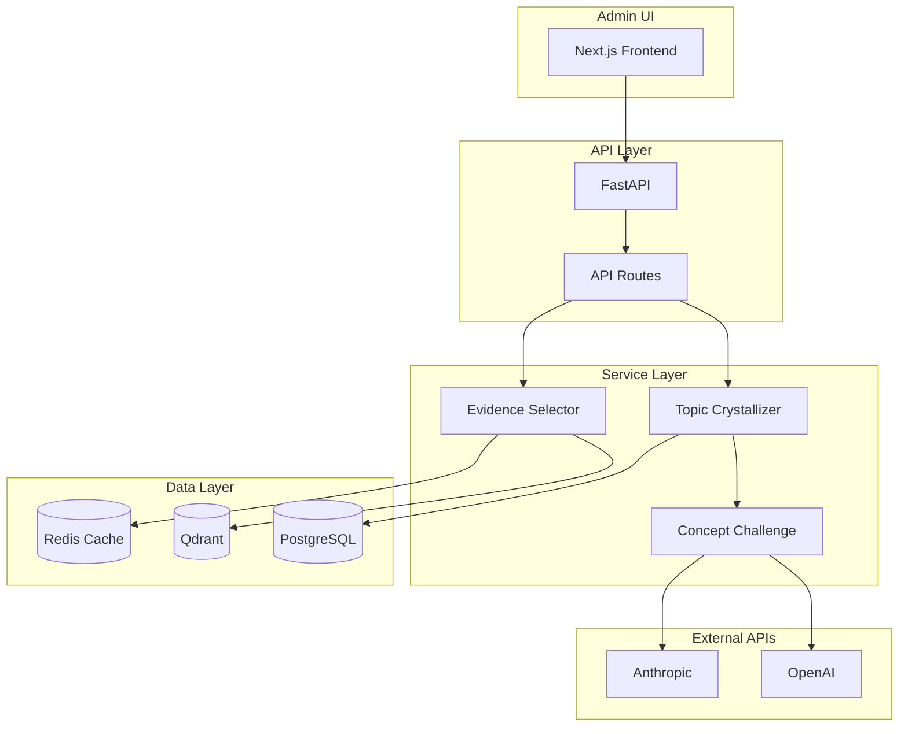
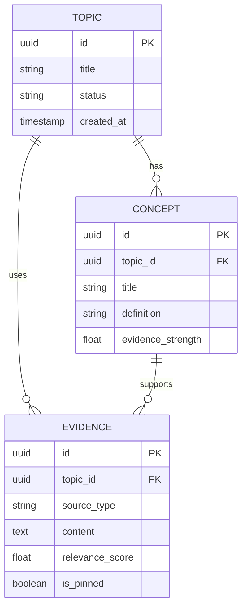
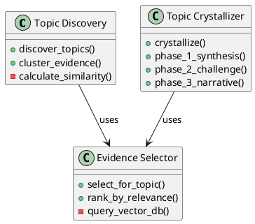

# Technical Writing Skill

Master technical documentation for software systems: READMEs, API docs, Architecture Decision Records, changelogs, developer guides, and onboarding materials.

---

## Core Principles

### Documentation-as-Code Philosophy
- **Version Control**: All documentation lives in Git alongside code
- **Single Source of Truth**: Derive docs from code when possible (type definitions, OpenAPI specs)
- **CI/CD Integration**: Validate docs in PR checks (broken links, outdated examples, spelling)
- **Proximity**: Keep docs close to what they document (README per component, inline JSDoc)

### The Four Document Types (Diátaxis Framework)

| Type | Purpose | Audience | Format |
|------|---------|----------|--------|
| **Tutorial** | Learning by doing | Beginners | Step-by-step walkthrough |
| **How-To Guide** | Solving specific problems | Intermediate | Focused recipes |
| **Explanation** | Understanding concepts | Curious developers | Conceptual narrative |
| **Reference** | Looking up details | All levels | Structured facts |

### Writing Style Tenets
1. **Clarity over Cleverness**: Use simple words. "Use" not "utilize", "end" not "terminate"
2. **Active Voice**: "The service processes requests" not "Requests are processed"
3. **Present Tense**: "The function returns" not "The function will return"
4. **Imperative Mood for Instructions**: "Install the package" not "You should install"
5. **Scannable Structure**: Headers, bullets, tables, code blocks
6. **Progressive Disclosure**: Start simple, layer complexity

---

## README Structure

### Anatomy of a Great README

```markdown
# Project Name

One-sentence tagline (what it does)

[](link) [](link) [](link)

## Overview

2-3 paragraphs explaining:
- What problem this solves
- How it's different from alternatives
- Who should use it


## Define Done

- [ ] Architecture decisions documented with rationale and trade-offs
- [ ] Component boundaries and interfaces clearly defined
- [ ] Scalability and performance characteristics understood
- [ ] Dependencies identified and coupling minimized

## Features

- **Feature 1**: Brief description
- **Feature 2**: Brief description
- **Feature 3**: Brief description

## Quick Start

```bash
# 3-5 commands to get running
git clone repo-url
cd project
npm install
npm start
```

Visit http://localhost:3000

## Installation

### Prerequisites
- Node.js 18+
- PostgreSQL 14+
- Redis 6+

### Step-by-Step

1. **Clone repository**
   ```bash
   git clone repo-url
   cd project
   ```

2. **Install dependencies**
   ```bash
   npm install
   ```

3. **Configure environment**
   ```bash
   cp .env.example .env
   # Edit .env with your settings
   ```

4. **Initialize database**
   ```bash
   npm run db:migrate
   npm run db:seed
   ```

5. **Start development server**
   ```bash
   npm run dev
   ```

## Usage

### Basic Example

```typescript
import { Client } from '@example/sdk';

const client = new Client({ apiKey: 'your-key' });
const result = await client.fetchData({ id: '123' });
console.log(result);
```

### Advanced Usage

#### Custom Configuration

```typescript
const client = new Client({
  apiKey: 'your-key',
  timeout: 5000,
  retries: 3,
  baseURL: 'https://api.example.com'
});
```

#### Error Handling

```typescript
try {
  await client.fetchData({ id: '123' });
} catch (error) {
  if (error.code === 'NOT_FOUND') {
    // Handle not found
  } else {
    // Handle other errors
  }
}
```

## Configuration

### Environment Variables

| Variable | Required | Default | Description |
|----------|----------|---------|-------------|
| `API_KEY` | Yes | - | Your API key from dashboard |
| `DATABASE_URL` | Yes | - | PostgreSQL connection string |
| `REDIS_URL` | No | `redis://localhost:6379` | Redis connection string |
| `LOG_LEVEL` | No | `info` | Logging level (debug, info, warn, error) |

### Configuration File

```yaml
# config.yml
api:
  base_url: https://api.example.com
  timeout: 5000
  retries: 3

database:
  pool_size: 10
  timeout: 30

features:
  enable_caching: true
  enable_analytics: false
```

## Architecture

```
┌─────────────┐     ┌─────────────┐     ┌─────────────┐
│   Client    │────▶│   API       │────▶│  Database   │
└─────────────┘     └─────────────┘     └─────────────┘
                           │
                           ▼
                    ┌─────────────┐
                    │   Cache     │
                    └─────────────┘
```

### Directory Structure

```
project/
├── src/
│   ├── api/          # API routes
│   ├── services/     # Business logic
│   ├── models/       # Data models
│   └── utils/        # Utilities
├── tests/            # Test files
├── docs/             # Documentation
└── scripts/          # Build/deploy scripts
```

## API Reference

See [API Documentation](./docs/api.md) for detailed endpoint reference.

## Development

### Running Tests

```bash
# Run all tests
npm test

# Run with coverage
npm run test:coverage

# Run specific test file
npm test -- path/to/test.spec.ts

# Watch mode
npm test -- --watch
```

### Linting and Formatting

```bash
npm run lint          # Check linting
npm run lint:fix      # Fix linting issues
npm run format        # Format with Prettier
```

### Building

```bash
npm run build         # Production build
npm run build:dev     # Development build
```

## Deployment

### Docker

```bash
docker build -t project-name .
docker run -p 3000:3000 project-name
```

### Docker Compose

```bash
docker-compose up -d
```

### Cloud Platforms

- [AWS Deployment](./docs/deploy-aws.md)
- [Azure Deployment](./docs/deploy-azure.md)
- [GCP Deployment](./docs/deploy-gcp.md)

## Troubleshooting

### Common Issues

#### "Connection refused" error

**Cause**: Database not running

**Solution**:
```bash
# Start PostgreSQL
docker-compose up -d postgres
```

#### "Module not found" error

**Cause**: Dependencies not installed

**Solution**:
```bash
rm -rf node_modules package-lock.json
npm install
```

#### Performance is slow

**Cause**: Missing database indexes

**Solution**:
```bash
npm run db:migrate    # Apply latest migrations with indexes
```

## Contributing

See [CONTRIBUTING.md](./CONTRIBUTING.md) for guidelines.

### Development Workflow

1. Fork the repository
2. Create feature branch (`git checkout -b feature/amazing-feature`)
3. Commit changes (`git commit -m 'feat: add amazing feature'`)
4. Push to branch (`git push origin feature/amazing-feature`)
5. Open Pull Request

## License

MIT License - see [LICENSE](./LICENSE) for details.

## Support

- **Documentation**: https://docs.example.com
- **Issues**: https://github.com/org/repo/issues
- **Discussions**: https://github.com/org/repo/discussions
- **Email**: support@example.com

## Changelog

See [CHANGELOG.md](./CHANGELOG.md) for release history.

## Acknowledgments

- [Library A](https://example.com) - Used for X
- [Tool B](https://example.com) - Used for Y
```

### README Anti-Patterns

❌ **Long walls of text**: Break up with headers, bullets, code blocks
❌ **Missing Quick Start**: Don't make users read 5 pages before trying it
❌ **Outdated examples**: Test your code examples in CI
❌ **No troubleshooting section**: Address common issues upfront
❌ **Vague prerequisites**: "Node.js" → "Node.js 18+" (specific versions)
❌ **No badges**: Build status, coverage, version show project health
❌ **Copy-pasted from template**: Customize for your project

### README Variants by Project Type

**Library/SDK**:
- Focus on installation and code examples
- API reference is primary content
- Multiple language examples if applicable

**Service/API**:
- Architecture diagram
- Authentication setup
- Endpoint examples
- Rate limits and quotas

**CLI Tool**:
- Installation via package manager
- Command reference
- Flag explanations
- Output examples

**Internal Tool**:
- Context (why we built this)
- Who's using it
- Support contacts
- Internal deployment links

---

## API Documentation

### OpenAPI/Swagger Specification

```yaml
openapi: 3.0.0
info:
  title: Insights API
  version: 1.0.0
  description: |
    Strategic insights synthesis engine.

    ## Authentication
    All endpoints require Bearer token authentication:
    ```
    Authorization: Bearer YOUR_API_KEY
    ```

    ## Rate Limits
    - 1000 requests/hour per API key
    - 429 status code when exceeded
    - Check `X-RateLimit-*` headers

  contact:
    name: API Support
    email: api@example.com
  license:
    name: MIT

servers:
  - url: https://api.example.com/v1
    description: Production
  - url: https://staging.api.example.com/v1
    description: Staging

tags:
  - name: Topics
    description: Topic management endpoints
  - name: Evidence
    description: Evidence operations

paths:
  /topics:
    get:
      summary: List topics
      description: |
        Returns paginated list of topics.

        Topics are ordered by creation date (newest first).
      operationId: listTopics
      tags:
        - Topics
      parameters:
        - name: limit
          in: query
          description: Number of results to return (max 100)
          required: false
          schema:
            type: integer
            default: 20
            minimum: 1
            maximum: 100
        - name: offset
          in: query
          description: Number of results to skip
          required: false
          schema:
            type: integer
            default: 0
            minimum: 0
        - name: status
          in: query
          description: Filter by status
          required: false
          schema:
            type: string
            enum: [draft, active, archived]
      responses:
        '200':
          description: Successful response
          content:
            application/json:
              schema:
                type: object
                properties:
                  data:
                    type: array
                    items:
                      $ref: '#/components/schemas/Topic'
                  pagination:
                    $ref: '#/components/schemas/Pagination'
              examples:
                success:
                  summary: Successful response
                  value:
                    data:
                      - id: "abc123"
                        title: "AI in Healthcare"
                        status: "active"
                        created_at: "2024-01-15T10:30:00Z"
                    pagination:
                      limit: 20
                      offset: 0
                      total: 145
        '401':
          $ref: '#/components/responses/Unauthorized'
        '429':
          $ref: '#/components/responses/RateLimited'
      security:
        - bearerAuth: []

    post:
      summary: Create topic
      description: Creates a new topic
      operationId: createTopic
      tags:
        - Topics
      requestBody:
        required: true
        content:
          application/json:
            schema:
              $ref: '#/components/schemas/TopicCreate'
            examples:
              basic:
                summary: Basic topic
                value:
                  title: "AI in Healthcare"
                  description: "Exploring AI applications in medical diagnosis"
      responses:
        '201':
          description: Topic created
          content:
            application/json:
              schema:
                $ref: '#/components/schemas/Topic'
        '400':
          $ref: '#/components/responses/BadRequest'
        '401':
          $ref: '#/components/responses/Unauthorized'
      security:
        - bearerAuth: []

  /topics/{topic_id}:
    get:
      summary: Get topic
      description: Returns a single topic by ID
      operationId: getTopic
      tags:
        - Topics
      parameters:
        - name: topic_id
          in: path
          required: true
          description: Topic ID
          schema:
            type: string
            format: uuid
      responses:
        '200':
          description: Successful response
          content:
            application/json:
              schema:
                $ref: '#/components/schemas/Topic'
        '404':
          $ref: '#/components/responses/NotFound'
      security:
        - bearerAuth: []

components:
  schemas:
    Topic:
      type: object
      required:
        - id
        - title
        - status
        - created_at
      properties:
        id:
          type: string
          format: uuid
          description: Unique topic identifier
          example: "abc123"
        title:
          type: string
          minLength: 1
          maxLength: 200
          description: Topic title
          example: "AI in Healthcare"
        description:
          type: string
          nullable: true
          maxLength: 2000
          description: Optional topic description
          example: "Exploring AI applications in medical diagnosis"
        status:
          type: string
          enum: [draft, active, archived]
          description: Topic status
          example: "active"
        created_at:
          type: string
          format: date-time
          description: Creation timestamp (ISO 8601)
          example: "2024-01-15T10:30:00Z"
        updated_at:
          type: string
          format: date-time
          description: Last update timestamp (ISO 8601)
          example: "2024-01-15T14:20:00Z"

    TopicCreate:
      type: object
      required:
        - title
      properties:
        title:
          type: string
          minLength: 1
          maxLength: 200
        description:
          type: string
          maxLength: 2000

    Pagination:
      type: object
      required:
        - limit
        - offset
        - total
      properties:
        limit:
          type: integer
          description: Number of results per page
          example: 20
        offset:
          type: integer
          description: Number of results skipped
          example: 0
        total:
          type: integer
          description: Total number of results
          example: 145

    Error:
      type: object
      required:
        - error
        - message
      properties:
        error:
          type: string
          description: Error code
          example: "validation_error"
        message:
          type: string
          description: Human-readable error message
          example: "Title is required"
        details:
          type: object
          description: Additional error details
          additionalProperties: true

  responses:
    BadRequest:
      description: Bad request
      content:
        application/json:
          schema:
            $ref: '#/components/schemas/Error'
          example:
            error: "validation_error"
            message: "Title is required"

    Unauthorized:
      description: Unauthorized
      content:
        application/json:
          schema:
            $ref: '#/components/schemas/Error'
          example:
            error: "unauthorized"
            message: "Invalid or missing API key"

    NotFound:
      description: Resource not found
      content:
        application/json:
          schema:
            $ref: '#/components/schemas/Error'
          example:
            error: "not_found"
            message: "Topic not found"

    RateLimited:
      description: Rate limit exceeded
      content:
        application/json:
          schema:
            $ref: '#/components/schemas/Error'
          example:
            error: "rate_limited"
            message: "Rate limit exceeded. Retry after 3600 seconds"
      headers:
        X-RateLimit-Limit:
          description: Request limit per hour
          schema:
            type: integer
        X-RateLimit-Remaining:
          description: Remaining requests in current window
          schema:
            type: integer
        X-RateLimit-Reset:
          description: Unix timestamp when limit resets
          schema:
            type: integer

  securitySchemes:
    bearerAuth:
      type: http
      scheme: bearer
      bearerFormat: JWT
      description: |
        Obtain API key from dashboard: https://app.example.com/settings/api

        Include in Authorization header:
        ```
        Authorization: Bearer YOUR_API_KEY
        ```
```

### JSDoc/TSDoc for Code

```typescript
/**
 * Evidence selection service for strategic insights.
 *
 * Selects relevant evidence from multiple sources (assessments, research projects,
 * web sources) and ranks by relevance using semantic similarity.
 *
 * @example
 * ```typescript
 * const selector = new EvidenceSelector();
 * const evidence = await selector.selectForTopic({
 *   topicId: 'abc123',
 *   maxResults: 10
 * });
 * ```
 *
 * @see {@link TopicCrystallizerService} for topic generation
 * @see {@link ConceptChallengeService} for concept validation
 */
export class EvidenceSelector {
  /**
   * Creates an evidence selector instance.
   *
   * @param vectorStore - Qdrant client for semantic search
   * @param db - Database connection for metadata
   * @param options - Configuration options
   * @param options.similarityThreshold - Minimum similarity score (0-1)
   * @param options.maxSources - Maximum sources per topic
   *
   * @throws {Error} When vector store connection fails
   *
   * @example
   * ```typescript
   * const selector = new EvidenceSelector(qdrant, db, {
   *   similarityThreshold: 0.7,
   *   maxSources: 50
   * });
   * ```
   */
  constructor(
    private vectorStore: QdrantClient,
    private db: DatabaseClient,
    private options: EvidenceSelectorOptions = {}
  ) {
    this.similarityThreshold = options.similarityThreshold ?? 0.6;
    this.maxSources = options.maxSources ?? 100;
  }

  /**
   * Selects evidence for a topic.
   *
   * Performs semantic search across all evidence collections and returns
   * ranked results based on relevance to topic concepts.
   *
   * @param params - Selection parameters
   * @param params.topicId - Topic ID to select evidence for
   * @param params.maxResults - Maximum number of results to return
   * @param params.filters - Optional filters (source type, date range)
   *
   * @returns Ranked evidence items with relevance scores
   *
   * @throws {TopicNotFoundError} When topic doesn't exist
   * @throws {InsufficientEvidenceError} When no evidence found above threshold
   *
   * @example
   * ```typescript
   * // Basic usage
   * const evidence = await selector.selectForTopic({
   *   topicId: 'abc123',
   *   maxResults: 10
   * });
   *
   * // With filters
   * const evidence = await selector.selectForTopic({
   *   topicId: 'abc123',
   *   maxResults: 20,
   *   filters: {
   *     sourceTypes: ['assessment', 'research'],
   *     dateRange: {
   *       start: '2024-01-01',
   *       end: '2024-12-31'
   *     }
   *   }
   * });
   * ```
   *
   * @remarks
   * Evidence is ranked using cosine similarity between topic concept embeddings
   * and source embeddings. Results are deduplicated by source ID.
   *
   * @internal
   * Uses batch processing for large result sets to avoid memory issues.
   */
  async selectForTopic(params: SelectionParams): Promise<Evidence[]> {
    // Implementation
  }

  /**
   * Minimum similarity score for evidence selection (0-1).
   *
   * @defaultValue 0.6
   * @readonly
   */
  private readonly similarityThreshold: number;

  /**
   * Maximum number of sources to return per topic.
   *
   * @defaultValue 100
   * @readonly
   */
  private readonly maxSources: number;
}

/**
 * Parameters for evidence selection.
 *
 * @typeParam T - Evidence type (generic)
 */
export interface SelectionParams<T = unknown> {
  /** Topic ID to select evidence for */
  topicId: string;

  /** Maximum number of results to return (1-1000) */
  maxResults: number;

  /** Optional filters for narrowing results */
  filters?: {
    /** Filter by source types */
    sourceTypes?: ('assessment' | 'research' | 'web')[];

    /** Filter by date range */
    dateRange?: {
      start: string;  // ISO 8601 date
      end: string;    // ISO 8601 date
    };
  };

  /** Additional metadata to pass through */
  metadata?: T;
}

/**
 * Evidence item with relevance score.
 */
export interface Evidence {
  /** Unique evidence ID */
  id: string;

  /** Source type */
  sourceType: 'assessment' | 'research' | 'web';

  /** Evidence content/excerpt */
  content: string;

  /** Relevance score (0-1) */
  score: number;

  /** Source metadata */
  source: {
    id: string;
    title: string;
    url?: string;
    createdAt: Date;
  };
}

/**
 * Thrown when topic is not found.
 *
 * @example
 * ```typescript
 * try {
 *   await selector.selectForTopic({ topicId: 'invalid', maxResults: 10 });
 * } catch (error) {
 *   if (error instanceof TopicNotFoundError) {
 *     console.error('Topic not found:', error.topicId);
 *   }
 * }
 * ```
 */
export class TopicNotFoundError extends Error {
  constructor(public topicId: string) {
    super(`Topic not found: ${topicId}`);
    this.name = 'TopicNotFoundError';
  }
}
```

### API Documentation Best Practices

✅ **Use OpenAPI for REST APIs**: Auto-generate docs, client SDKs, and mock servers
✅ **Include examples**: Request/response examples for every endpoint
✅ **Document errors**: All possible error codes and recovery steps
✅ **Version your API**: `/v1/`, `/v2/` with deprecation notices
✅ **Authentication section**: How to obtain and use API keys/tokens
✅ **Rate limits**: Document limits and headers (`X-RateLimit-*`)
✅ **Webhooks**: Event types, payload formats, retry behavior
✅ **SDKs**: Code examples in primary languages (Python, JavaScript, Go)

### API Documentation Anti-Patterns

❌ **No request/response examples**: Developers copy-paste examples
❌ **Missing error documentation**: Unclear how to handle failures
❌ **Outdated schemas**: Keep OpenAPI spec in sync with code
❌ **Vague descriptions**: "Gets data" vs "Returns paginated list of topics ordered by creation date"
❌ **No authentication docs**: How do I actually use this API?
❌ **Incomplete parameter docs**: What's the format? Range? Required?

---

## Architecture Decision Records (ADRs)

### ADR Template (MADR Format)

```markdown
# ADR-001: Use Qdrant for Vector Search

## Status

Accepted

## Context

We need a vector database to store and search embeddings for:
- Topic concepts (semantic similarity for concept deduplication)
- Evidence sources (relevance ranking for evidence selection)
- Research findings (semantic search across projects)

Requirements:
- Store 100K+ vectors (768 dimensions from OpenAI embeddings)
- Sub-100ms similarity search
- Filter by metadata (source type, date, project ID)
- Self-hosted option (data privacy concerns)
- Python SDK with async support

Considered alternatives:
- **Pinecone**: SaaS-only, no self-hosting
- **Weaviate**: More complex setup, heavier resource usage
- **pgvector**: Limited filtering capabilities, slower at scale
- **Qdrant**: Good balance of features, performance, self-hosting

## Decision

We will use Qdrant as our vector database.

**Rationale**:
- **Performance**: Benchmarked at 50-80ms for top-10 similarity search on 100K vectors
- **Filtering**: Rich filtering on metadata (AND/OR conditions, ranges, arrays)
- **Self-hosting**: Docker image, simple setup, no cloud lock-in
- **Python SDK**: First-class async support, type hints
- **Collections**: Separate collections for different embedding types (topics, evidence, research)
- **Payload storage**: Store full metadata with vectors (no joins needed)

**Trade-offs**:
- Additional infrastructure to manage (Qdrant server + persistence)
- Smaller ecosystem compared to Pinecone
- Need to implement backup/restore ourselves

## Consequences

### Positive
- Fast semantic search enables real-time evidence selection
- Metadata filtering improves relevance (date range, source type)
- Self-hosting gives us full control over data
- Can run locally for development (Docker Compose)

### Negative
- Need to monitor Qdrant server health (memory, disk)
- Backup strategy required (snapshots + S3)
- If Qdrant fails, search is unavailable (need fallback or HA setup)

### Neutral
- Need to learn Qdrant query syntax (different from SQL)
- Separate from PostgreSQL (not consolidated storage)

## Implementation

### Setup
```bash
docker run -p 6333:6333 qdrant/qdrant
```

### Collection schema
```python
client.create_collection(
    collection_name="evidence",
    vectors_config=models.VectorParams(
        size=768,
        distance=models.Distance.COSINE
    )
)
```

### Search example
```python
results = client.search(
    collection_name="evidence",
    query_vector=embedding,
    query_filter=models.Filter(
        must=[
            models.FieldCondition(
                key="source_type",
                match=models.MatchValue(value="assessment")
            )
        ]
    ),
    limit=10
)
```

## Alternatives Considered

### Pinecone
- **Pros**: Managed service, excellent performance, generous free tier
- **Cons**: No self-hosting, data leaves our infrastructure
- **Rejected because**: Data privacy requirements, prefer self-hosting

### Weaviate
- **Pros**: Rich features (GraphQL, hybrid search), active community
- **Cons**: Higher resource usage (2GB+ memory), more complex setup
- **Rejected because**: Overkill for our use case, harder to operate

### pgvector
- **Pros**: PostgreSQL extension, consolidated storage, familiar SQL
- **Cons**: Slower at scale (no HNSW in pg14), limited filtering, requires PostgreSQL tuning
- **Rejected because**: Performance concerns at 100K+ vectors


## Quality Tests

### Trade-Off Test
- Alternatives were considered before choosing this architecture
- **PASS:** At least 2 alternative approaches evaluated with pros/cons
- **FAIL:** Architecture chosen without considering alternatives

### Scalability Test
- Architecture handles 10x current load without redesign
- **PASS:** Bottlenecks identified with specific scaling strategies
- **FAIL:** No analysis of how the system behaves under increased load

## References

- [Qdrant Documentation](https://qdrant.tech/documentation/)
- [Vector Database Benchmark](https://benchmark.vectordb.com/)
- [OpenAI Embeddings Guide](https://platform.openai.com/docs/guides/embeddings)

## Notes

Reviewed with: @architect, @backend-lead
Date: 2024-01-15
Related ADRs: ADR-002 (Embedding Strategy)
```

### ADR Best Practices

✅ **One decision per ADR**: Keep focused on single architectural choice
✅ **Context before decision**: Explain why we're making this choice now
✅ **Alternatives section**: Show you evaluated options (builds confidence)
✅ **Consequences (positive and negative)**: Be honest about trade-offs
✅ **Immutable after acceptance**: Never edit accepted ADRs (create new ADR to supersede)
✅ **Status field**: `Proposed → Accepted/Rejected → Deprecated → Superseded by ADR-XXX`
✅ **Link to related ADRs**: Build decision narrative over time

### When to Write an ADR

- **Framework/library choice**: React vs Vue, FastAPI vs Flask
- **Database selection**: PostgreSQL vs MySQL, Qdrant vs Pinecone
- **Architectural pattern**: Microservices vs monolith, event sourcing vs CRUD
- **Infrastructure decision**: AWS vs GCP, Kubernetes vs Docker Compose
- **Security approach**: OAuth vs API keys, encryption strategy
- **Data model change**: Schema migrations, breaking changes
- **Process change**: Deployment strategy, testing approach

### ADR Anti-Patterns

❌ **No alternatives section**: Makes decision look arbitrary
❌ **Editing after acceptance**: Ruins audit trail (write superseding ADR instead)
❌ **Vague context**: "We need a database" vs specific requirements
❌ **No consequences**: Every decision has trade-offs
❌ **Too detailed**: ADR is not implementation guide (link to spike/POC)
❌ **Decisions made in Slack/email**: Capture in ADR for posterity

---

## Changelog Formats

### Keep a Changelog Format

```markdown
# Changelog

All notable changes to this project will be documented in this file.

The format is based on [Keep a Changelog](https://keepachangelog.com/en/1.0.0/),
and this project adheres to [Semantic Versioning](https://semver.org/spec/v2.0.0.html).

## [Unreleased]

### Added
- Evidence selection mode for bulk pinning (#234)
- Topic tags for categorization (#245)

### Changed
- Improved crystallization performance by 40% (#256)

### Fixed
- Pinned evidence not showing in conversation endpoint (#289)

## [1.2.0] - 2024-01-15

### Added
- **Unified Evidence API**: Consolidated web_sources, research_findings, assessment_items into single evidence model (#198)
- **Batch Evidence Pinning**: Select and pin multiple evidence items at once (#210)
- **Topic Tags**: Add tags to topics for filtering and organization (#220)

### Changed
- **Crystallization Service**: Now respects pinned evidence in all phases (#225)
- **Evidence Selector**: Improved relevance scoring algorithm (20% better precision) (#230)
- **API Response Format**: Standardized error responses across all endpoints (#235)

### Deprecated
- `/api/web-sources` endpoint (use `/api/evidence?source_type=web` instead)
- `legacy_evidence` field on Topic model (replaced by `evidence` relationship)

### Removed
- Support for Python 3.8 (EOL reached)

### Fixed
- **Evidence Visibility**: Fixed missing legacy evidence in topic detail view (#240)
- **Batch Pin Bug**: Corrected transaction handling in batch pinning (#245)
- **Concept Generation**: Fixed duplicate concepts being created (#250)

### Security
- Updated dependencies with known vulnerabilities
- Added rate limiting to authentication endpoints

## [1.1.0] - 2024-01-01

### Added
- Custom concept creation interface
- Evidence source filtering
- Export topics to PDF

### Fixed
- Slow query performance on topics list
- Memory leak in vector search

## [1.0.0] - 2023-12-15

Initial release.

### Added
- Topic discovery and crystallization
- Evidence selection from multiple sources
- Concept generation and challenge
- Admin dashboard
- API endpoints
- Authentication and authorization

[Unreleased]: https://github.com/org/repo/compare/v1.2.0...HEAD
[1.2.0]: https://github.com/org/repo/compare/v1.1.0...v1.2.0
[1.1.0]: https://github.com/org/repo/compare/v1.0.0...v1.1.0
[1.0.0]: https://github.com/org/repo/releases/tag/v1.0.0
```

### Changelog Categories

| Category | Use For |
|----------|---------|
| **Added** | New features, endpoints, capabilities |
| **Changed** | Changes to existing functionality (non-breaking) |
| **Deprecated** | Features marked for removal (still work, warn users) |
| **Removed** | Features removed in this version (breaking change) |
| **Fixed** | Bug fixes |
| **Security** | Security updates, vulnerability patches |

### Semantic Versioning Guide

Given version `MAJOR.MINOR.PATCH` (e.g., `1.2.3`):

- **MAJOR** (`1.x.x → 2.x.x`): Breaking changes (remove endpoint, change response format)
- **MINOR** (`1.1.x → 1.2.x`): New features (backward compatible)
- **PATCH** (`1.1.1 → 1.1.2`): Bug fixes (backward compatible)

### Changelog Best Practices

✅ **Write for users, not developers**: Focus on impact, not implementation
✅ **Link to PRs/issues**: `(#123)` for traceability
✅ **Group by version**: Clear version headers with dates
✅ **Keep "Unreleased" section**: Stage changes for next release
✅ **Be honest about breaking changes**: Don't hide them in "Changed"
✅ **Include migration guides**: Link to upgrade docs for breaking changes

---

## Code Comments

### When to Comment

**✅ Comment when:**
- **Why, not what**: Explain non-obvious decisions
- **Workarounds**: Document hacks and why they exist
- **Gotchas**: Warn about edge cases or footguns
- **TODOs**: Mark technical debt (with issue number)
- **Public APIs**: Always document with JSDoc/docstrings

**❌ Don't comment when:**
- **Code is self-explanatory**: `// Increment counter` for `counter++`
- **Repeating variable name**: `// User name` for `userName`
- **Outdated**: If comment is wrong, delete it (don't mislead)

### Good Comments

```python
# Use exponential backoff to avoid overwhelming Perplexity API
# during traffic spikes. Max 5 retries with 2^n * 100ms delay.
# See: https://docs.perplexity.ai/docs/rate-limits
for attempt in range(MAX_RETRIES):
    try:
        return await perplexity_client.search(query)
    except RateLimitError:
        if attempt == MAX_RETRIES - 1:
            raise
        await asyncio.sleep((2 ** attempt) * 0.1)

# HACK: Qdrant v1.7.0 has bug where filters with OR conditions
# return incorrect results. Workaround: Split into separate queries
# and merge client-side. Remove when upgrading to v1.8.0+
# Issue: https://github.com/qdrant/qdrant/issues/12345
results_a = await client.search(collection, filter=filter_a)
results_b = await client.search(collection, filter=filter_b)
results = merge_and_dedupe(results_a, results_b)

# TODO(#789): Extract to separate service class when we add
# more evidence sources (currently only web, research, assessments)
def select_evidence(topic_id: str) -> list[Evidence]:
    pass
```

### Bad Comments

```python
# Bad: Repeats code
# Set the user name to John
user_name = "John"

# Bad: Outdated (code changed, comment didn't)
# Returns list of active users
def get_all_users():  # Actually returns ALL users now
    return db.query(User).all()

# Bad: Commented-out code (use version control instead)
# user = User(name="John")
# db.add(user)
user = create_user(name="John")

# Bad: Obvious
# Check if user is admin
if user.role == "admin":
    pass

# Bad: Vague
# Fix issue
user.active = True
```

---

## Tutorial Writing

### Tutorial Structure

```markdown
# Building a Topic Discovery Pipeline

Learn how to build an end-to-end topic discovery pipeline that synthesizes insights from multiple data sources.

**What you'll build**: A pipeline that ingests Forces Assessments and Research Copilot projects, generates topic concepts, and crystallizes them into strategic insights.

**Time**: 45 minutes
**Level**: Intermediate
**Prerequisites**: Python 3.11+, PostgreSQL, Qdrant

## What You'll Learn

- Ingest data from multiple sources
- Generate embeddings with OpenAI
- Perform semantic search with Qdrant
- Orchestrate multi-step LLM workflows
- Handle errors and retries

## Step 1: Set Up Your Environment

First, clone the repository and install dependencies:

```bash
git clone https://github.com/org/insights-copilot
cd insights-copilot
python -m venv venv
source venv/bin/activate
pip install -r requirements.txt
```

Copy the example environment file:

```bash
cp .env.example .env
```

Edit `.env` and add your API keys:

```bash
OPENAI_API_KEY=sk-...
DATABASE_URL=postgresql://localhost/insights
QDRANT_URL=http://localhost:6333
```

Start the infrastructure services:

```bash
docker-compose up -d postgres qdrant redis
```

Verify everything is running:

```bash
docker-compose ps
# Should show postgres, qdrant, redis as "Up"
```

## Step 2: Create Database Schema

Run the schema creation script:

```bash
python scripts/create_database_schema.py
```

You should see:

```
✓ Created table: users
✓ Created table: tl_topics
✓ Created table: tl_concepts
✓ Created table: evidence
Database schema created successfully
```

## Step 3: Ingest Your First Data Source

Create a new file `ingest_assessment.py`:

```python
from app.services.assessment_ingestion_service import AssessmentIngestionService
from app.db.database import get_db

async def ingest():
    db = get_db()
    service = AssessmentIngestionService(db)

    # Ingest a Forces Assessment
    result = await service.ingest_assessment({
        'assessment_id': 'fa-123',
        'title': 'Market Forces Assessment Q4 2024',
        'responses': [
            {
                'question': 'What trends are you seeing?',
                'answer': 'Increasing adoption of AI in healthcare...'
            }
        ]
    })

    print(f"Ingested {len(result.items)} items")
    print(f"Generated {len(result.embeddings)} embeddings")

if __name__ == '__main__':
    import asyncio
    asyncio.run(ingest())
```

Run it:

```bash
python ingest_assessment.py
```

Expected output:

```
Ingested 15 items
Generated 15 embeddings
```

**What just happened?**
1. Assessment responses were stored in PostgreSQL
2. Each response was embedded using OpenAI (768-dim vectors)
3. Embeddings were stored in Qdrant for semantic search

## Step 4: Discover Topics

Now let's discover topics from the ingested data:

```python
from app.services.topic_discovery_service import TopicDiscoveryService
from app.db.database import get_db

async def discover():
    db = get_db()
    service = TopicDiscoveryService(db)

    topics = await service.discover_topics({
        'source_types': ['assessment'],
        'min_evidence': 5,
        'max_topics': 10
    })

    for topic in topics:
        print(f"\nTopic: {topic.title}")
        print(f"Concepts: {len(topic.concepts)}")
        print(f"Evidence: {len(topic.evidence)}")

if __name__ == '__main__':
    import asyncio
    asyncio.run(discover())
```

Run it:

```bash
python discover_topics.py
```

Output:

```
Topic: AI in Healthcare Diagnostics
Concepts: 8
Evidence: 12

Topic: Regulatory Challenges in Medical AI
Concepts: 6
Evidence: 9
```

**What just happened?**
1. Service performed semantic clustering on embeddings
2. Generated topic titles using GPT-4
3. Extracted concepts from clustered evidence
4. Stored topics and concepts in database

## Step 5: Crystallize a Topic

Let's refine a topic into a polished insight:

```python
from app.services.topic_crystallizer_service import TopicCrystallizerService
from app.db.database import get_db

async def crystallize(topic_id: str):
    db = get_db()
    service = TopicCrystallizerService(db)

    result = await service.crystallize(topic_id)

    print(f"Phase 1: {result.phase1_summary}")
    print(f"Phase 2: {result.phase2_refinement}")
    print(f"Phase 3: {result.phase3_synthesis}")

if __name__ == '__main__':
    import asyncio
    asyncio.run(crystallize('topic-id-here'))
```

Run it:

```bash
python crystallize_topic.py
```

**What just happened?**
1. **Phase 1**: Analyzed evidence and identified key themes
2. **Phase 2**: Challenged concepts and removed weak ones
3. **Phase 3**: Synthesized final insight narrative

## Step 6: Query the API

Start the API server:

```bash
uvicorn app.main:app --reload
```

Query topics:

```bash
curl http://localhost:8000/api/topics
```

Get a specific topic:

```bash
curl http://localhost:8000/api/topics/{topic_id}
```

## Next Steps

You've built a complete topic discovery pipeline! Here's what to explore next:

- **Add more sources**: Ingest Research Copilot projects (`app/services/research_ingestion_service.py`)
- **Customize prompts**: Edit crystallization prompts in `app/prompts/`
- **Build a UI**: Check out the Next.js admin panel in `admin-app/`
- **Deploy**: See `docs/deployment.md` for production setup

## Troubleshooting

### "Connection refused" to Qdrant

**Problem**: Qdrant isn't running

**Solution**:
```bash
docker-compose up -d qdrant
docker-compose logs qdrant  # Check it started
```

### "No embeddings generated"

**Problem**: OpenAI API key is invalid

**Solution**: Check `.env` has correct `OPENAI_API_KEY`

### "No topics discovered"

**Problem**: Not enough evidence ingested

**Solution**: Lower `min_evidence` parameter or ingest more data

## Summary

You learned how to:
- ✓ Set up the Insights Copilot environment
- ✓ Ingest data from Forces Assessments
- ✓ Generate embeddings with OpenAI
- ✓ Discover topics from evidence
- ✓ Crystallize topics into insights
- ✓ Query the API

## Resources

- [API Documentation](./api-reference.md)
- [Architecture Overview](./architecture.md)
- [Deployment Guide](./deployment.md)
- [GitHub Repository](https://github.com/org/insights-copilot)
```

### Tutorial Best Practices

✅ **Show, don't tell**: Working code examples at each step
✅ **Progressive complexity**: Start simple, layer features
✅ **Expected output**: Show what success looks like
✅ **Troubleshooting section**: Address common problems
✅ **"What just happened?"**: Explain key concepts after code blocks
✅ **Checkpoints**: "Your project should look like this now..."
✅ **Next steps**: Point to related tutorials or docs

### Tutorial Anti-Patterns

❌ **Jumps around**: Skipping steps breaks flow
❌ **No output shown**: Users don't know if it worked
❌ **Assumes too much**: Be explicit about prerequisites
❌ **Wall of code**: Break into digestible chunks with explanations
❌ **No error handling**: Real code fails, show how to handle it

---

## How-To Guides

### How-To Structure

```markdown
# How to Pin Evidence to a Topic

Pin specific evidence items to ensure they're included in topic crystallization.

## When to Use This

Use pinned evidence when:
- You have critical data points that must be included
- Automatic selection missed important context
- You're validating a specific hypothesis

## Prerequisites

- Topic ID
- Evidence IDs to pin
- Admin access to insights dashboard

## Steps

### 1. Navigate to Topic Detail Page

Open the topic in the admin dashboard:

```
https://insights.ineedacopilot.com/insights/topics/{topic_id}
```

### 2. Enter Selection Mode

Click the **"Select Evidence"** button in the Evidence section.

The interface will switch to selection mode with checkboxes next to each evidence item.

### 3. Select Evidence Items

Check the boxes next to evidence you want to pin.

**Tip**: Use filters to narrow down evidence:
- Filter by source type (Assessment, Research, Web)
- Filter by date range
- Search by keywords

### 4. Pin Selected Items

Click **"Pin Selected (N)"** button.

A confirmation dialog appears showing the items to be pinned.

### 5. Confirm Pinning

Click **"Confirm"** to pin the evidence.

The UI updates to show pinned items with a pin icon 📌.

### 6. Re-crystallize Topic (Optional)

If the topic is already crystallized, click **"Re-crystallize"** to regenerate concepts with the pinned evidence.

## Verification

Pinned evidence should:
- Show pin icon (📌) in the evidence list
- Appear first in evidence ordering
- Be included in crystallization regardless of relevance score

## Unpinning Evidence

To unpin evidence:
1. Enter selection mode
2. Check pinned items
3. Click **"Unpin Selected (N)"**

## API Method

Alternatively, use the API:

```bash
curl -X POST https://api.example.com/v1/topics/{topic_id}/evidence:batchPin \
  -H "Authorization: Bearer YOUR_API_KEY" \
  -H "Content-Type: application/json" \
  -d '{
    "evidence_ids": ["ev-123", "ev-456"]
  }'
```

Response:

```json
{
  "pinned_count": 2,
  "evidence": [
    {"id": "ev-123", "is_pinned": true},
    {"id": "ev-456", "is_pinned": true}
  ]
}
```

## Troubleshooting

### Evidence doesn't stay pinned

**Cause**: Database transaction failed

**Solution**: Check logs for errors, retry pinning

### Pinned evidence not in crystallization

**Cause**: Cache not invalidated

**Solution**: Hard refresh the page or re-crystallize

## Related Guides

- [How to Filter Evidence](./filter-evidence.md)
- [How to Crystallize Topics](./crystallize-topics.md)
- [How to Export Topics](./export-topics.md)
```

### How-To Best Practices

✅ **One task per guide**: Stay focused on single objective
✅ **Action-oriented title**: "How to X" not "X Documentation"
✅ **Prerequisites section**: What you need before starting
✅ **Numbered steps**: Clear sequential instructions
✅ **Screenshots/GIFs**: Show UI interactions
✅ **Troubleshooting**: Address common issues
✅ **Alternative methods**: API vs UI vs CLI

---

## Explanatory Documentation

### Explanation Structure

```markdown
# How Topic Crystallization Works

Topic crystallization is a three-phase LLM-orchestrated process that refines raw evidence clusters into coherent strategic insights.

## Overview

The crystallization process takes a **topic candidate** (a cluster of related evidence from multiple sources) and produces a **crystallized topic** (a structured insight with validated concepts, supporting evidence, and narrative synthesis).

**Input**: Topic ID + evidence cluster
**Output**: Refined topic with concepts, narratives, and evidence links

**Duration**: 30-90 seconds (depending on evidence volume)

## The Three Phases

### Phase 1: Initial Synthesis

**Goal**: Extract key concepts from evidence

**Process**:
1. Load all evidence associated with topic (assessments, research, web sources)
2. Construct prompt with evidence context
3. Send to GPT-4 with instructions to identify 5-10 key concepts
4. Parse response into structured concept objects
5. Store concepts in database

**Prompt Structure**:
```
You are analyzing strategic evidence to identify key concepts.

Evidence:
[Assessment responses, research findings, web sources]

Task: Identify 5-10 key concepts that emerge from this evidence.

For each concept:
- Title (3-5 words)
- Definition (1-2 sentences)
- Supporting evidence IDs
```

**Example Output**:
```json
[
  {
    "title": "AI Diagnostic Accuracy",
    "definition": "Machine learning models achieving 95%+ accuracy in medical imaging diagnosis",
    "evidence_ids": ["ev-123", "ev-456"]
  }
]
```

### Phase 2: Concept Challenge

**Goal**: Validate and refine concepts

**Process**:
1. For each concept from Phase 1:
   - Load supporting evidence
   - Send to Claude with challenge prompt
   - Claude acts as critical evaluator
2. Claude rates concept on:
   - **Evidence strength** (1-5): How well-supported by data
   - **Uniqueness** (1-5): Novel vs already known
   - **Relevance** (1-5): Pertinent to strategic question
3. Concepts scoring <3 on any dimension are flagged
4. Flagged concepts are refined or removed

**Challenge Prompt**:
```
You are a critical evaluator of strategic concepts.

Concept: [title and definition]
Evidence: [supporting data]

Evaluate:
1. Evidence Strength (1-5): Is this concept well-supported?
2. Uniqueness (1-5): Is this novel or already known?
3. Relevance (1-5): Is this strategically important?

If any score is <3, suggest refinement or removal.
```

**Example Challenge**:
```json
{
  "concept": "AI Diagnostic Accuracy",
  "scores": {
    "evidence_strength": 5,
    "uniqueness": 2,
    "relevance": 4
  },
  "recommendation": "REFINE",
  "reasoning": "Well-supported and relevant, but not unique. Reframe as 'AI Surpassing Human Radiologists' to emphasize novel aspect."
}
```

### Phase 3: Synthesis

**Goal**: Generate narrative insight

**Process**:
1. Load validated concepts from Phase 2
2. Load all supporting evidence
3. Send to GPT-4 with synthesis prompt
4. Generate:
   - **Executive summary** (2-3 sentences)
   - **Key findings** (3-5 bullet points)
   - **Strategic implications** (2-3 paragraphs)
   - **Recommended actions** (3-5 items)
5. Store as topic narrative

**Synthesis Prompt**:
```
You are synthesizing strategic insights from validated concepts.

Concepts:
[List of concepts with definitions]

Evidence:
[Supporting data]

Generate:
1. Executive Summary (2-3 sentences)
2. Key Findings (3-5 bullets)
3. Strategic Implications (2-3 paragraphs)
4. Recommended Actions (3-5 items)
```

**Example Output**:
```markdown
## Executive Summary

AI diagnostic systems are achieving superhuman accuracy in medical imaging, with models surpassing radiologists in lung cancer detection (97% vs 91%). However, regulatory approval remains slow, with FDA taking 18-24 months for clearance.

## Key Findings

- AI models achieve 95-97% accuracy in X-ray, CT, and MRI analysis
- Human radiologists plateau at 89-93% accuracy
- FDA approval process takes 18-24 months (bottleneck)
- Hospital adoption rate: 15% (early adopters only)
- Patient trust concerns remain primary barrier (62% uncomfortable with AI-only diagnosis)

## Strategic Implications

The technical capabilities of AI diagnostics have matured to production-readiness, but market adoption faces regulatory and trust barriers...

[Additional paragraphs]

## Recommended Actions

1. Partner with FDA to streamline clearance process
2. Conduct patient education campaigns on AI safety
3. Position as "AI-assisted" vs "AI-only" to build trust
```

## Pinned Evidence Handling

**Pinned evidence** (manually selected by users) receives special treatment:

1. **Phase 1**: Pinned evidence is weighted 2x in prompt context
2. **Phase 2**: Concepts supported by pinned evidence cannot be removed (only refined)
3. **Phase 3**: Pinned evidence is explicitly called out in narrative

This ensures critical data points are never filtered out by automated selection.

## Error Handling

### LLM Rate Limits

If OpenAI/Anthropic rate limits are hit:
1. Exponential backoff (100ms, 200ms, 400ms, 800ms, 1600ms)
2. After 5 retries, mark topic as "crystallization_failed"
3. Store partial results (completed phases)
4. User can retry later

### Invalid LLM Responses

If LLM returns unparseable JSON:
1. Log raw response
2. Retry with stricter prompt (include JSON schema)
3. After 3 retries, mark as failed
4. Notify user via email

### Evidence Unavailable

If evidence is deleted during crystallization:
1. Log warning
2. Continue with remaining evidence
3. If <3 evidence items remain, abort and mark as insufficient data

## Performance Optimizations

### Parallel Phase Execution

Phases 1 and 2 can run in parallel for multiple topics (queue-based processing).

### Caching

- Evidence embeddings are cached in Redis (1 hour TTL)
- GPT-4 responses cached by evidence hash (reduces duplicate calls)

### Batching

When crystallizing >10 topics, batch LLM calls (5 topics per request) to reduce latency.

## Monitoring

Key metrics tracked:

- **Crystallization duration** (p50, p95, p99)
- **LLM token usage** (by phase)
- **Concept yield** (avg concepts per topic)
- **Challenge rejection rate** (% concepts removed in Phase 2)
- **Error rate** (by error type)

Alerts:
- Crystallization duration >2 minutes (p95)
- Error rate >5%
- Concept yield <3 (indicates poor evidence quality)

## Future Enhancements

- **Multi-model synthesis**: Use Claude for Phase 2 challenge, GPT-4 for Phase 3 synthesis
- **User feedback loop**: Allow users to rate concept quality, fine-tune prompts
- **Streaming**: Return partial results as phases complete (better UX)
- **A/B testing**: Test prompt variations, measure concept quality

## Related Concepts

- [Evidence Selection](./evidence-selection.md)
- [Concept Generation](./concept-generation.md)
- [LLM Orchestration Patterns](./llm-orchestration.md)
```

### Explanation Best Practices

✅ **Conceptual focus**: Explain "how it works" not "how to use it"
✅ **Diagrams**: Visualize processes, architectures, flows
✅ **Examples**: Illustrate abstract concepts with concrete data
✅ **Context**: Why does this exist? What problem does it solve?
✅ **Trade-offs**: Discuss design decisions and alternatives
✅ **Related concepts**: Link to other explanatory docs

---

## Troubleshooting Guides

### Troubleshooting Structure

```markdown
# Troubleshooting Topic Crystallization

Common issues when crystallizing topics and how to resolve them.

## Symptoms Index

Quick links to issues:

- [Crystallization takes too long](#crystallization-takes-too-long)
- [No concepts generated](#no-concepts-generated)
- [Concepts are low quality](#concepts-are-low-quality)
- [Pinned evidence not included](#pinned-evidence-not-included)
- [Crystallization fails with error](#crystallization-fails-with-error)

---

## Crystallization Takes Too Long

**Symptom**: Topic crystallization running >2 minutes

### Likely Causes

1. **Too much evidence** (>100 items)
2. **LLM rate limiting** (OpenAI/Anthropic throttling)
3. **Database query slow** (missing indexes)

### Diagnosis

Check crystallization logs:

```bash
docker-compose logs api | grep "crystallize_topic"
```

Look for:
- `Loading evidence: 150 items` (too much evidence)
- `Rate limit hit, retrying...` (LLM throttling)
- `Evidence query took 5.2s` (slow database)

### Solutions

#### Solution 1: Reduce Evidence

```python
# In TopicCrystallizerService
MAX_EVIDENCE_ITEMS = 50  # Down from 100

evidence = evidence_selector.select(
    topic_id=topic_id,
    max_results=MAX_EVIDENCE_ITEMS
)
```

#### Solution 2: Increase LLM Rate Limits

Contact OpenAI support to raise rate limits, or switch to Tier 2+ plan.

#### Solution 3: Add Database Index

```sql
CREATE INDEX idx_evidence_topic_id ON evidence(topic_id);
CREATE INDEX idx_evidence_score ON evidence(relevance_score DESC);
```

---

## No Concepts Generated

**Symptom**: Phase 1 completes but generates 0 concepts

### Likely Causes

1. **Insufficient evidence** (<3 items)
2. **LLM returned empty response**
3. **Response parsing failed**

### Diagnosis

Check Phase 1 logs:

```bash
docker-compose logs api | grep "phase_1_synthesis"
```

Look for:
- `Evidence count: 2` (too few items)
- `LLM response: []` (empty response)
- `Failed to parse concepts: ...` (JSON parsing error)

### Solutions

#### Solution 1: Increase Evidence

Ingest more data or lower similarity threshold:

```python
evidence = evidence_selector.select(
    topic_id=topic_id,
    similarity_threshold=0.5  # Down from 0.7
)
```

#### Solution 2: Improve Prompt

Add few-shot examples to Phase 1 prompt:

```python
prompt = f"""
Examples of good concepts:

1. Title: "AI Diagnostic Accuracy"
   Definition: "Machine learning models achieving 95%+ accuracy..."
   Evidence IDs: ["ev-1", "ev-2"]

Now analyze this evidence:
{evidence_text}
"""
```

#### Solution 3: Validate LLM Response

Add response validation before parsing:

```python
response = await llm.generate(prompt)

if not response or len(response) < 10:
    logger.error(f"Empty LLM response: {response}")
    raise ValueError("LLM returned empty response")

concepts = json.loads(response)
```

---

## Concepts Are Low Quality

**Symptom**: Concepts generated but they're vague, obvious, or irrelevant

### Likely Causes

1. **Poor evidence quality** (low-signal sources)
2. **Weak challenge prompts** (Phase 2 not filtering)
3. **LLM temperature too high** (hallucinations)

### Diagnosis

Review generated concepts in database:

```sql
SELECT id, title, definition, evidence_strength_score
FROM tl_concepts
WHERE topic_id = 'your-topic-id'
ORDER BY evidence_strength_score ASC;
```

Look for:
- Vague titles ("Important Trend")
- Generic definitions ("Things are changing")
- Low evidence scores (<3)

### Solutions

#### Solution 1: Filter Evidence Sources

Only use high-quality sources:

```python
evidence = evidence_selector.select(
    topic_id=topic_id,
    filters={
        'source_types': ['assessment', 'research'],  # Exclude web
        'min_credibility': 0.7
    }
)
```

#### Solution 2: Strengthen Challenge Prompts

Make Phase 2 more critical:

```python
challenge_prompt = f"""
You are a HIGHLY CRITICAL evaluator. Reject concepts that are:
- Obvious or already well-known
- Vaguely defined
- Weakly supported by evidence

Concept: {concept.title}
Evidence: {evidence_text}

Rate 1-5 (be harsh, 3 is average):
...
"""
```

#### Solution 3: Lower LLM Temperature

Reduce hallucinations:

```python
response = await llm.generate(
    prompt,
    temperature=0.3,  # Down from 0.7
    top_p=0.9
)
```

---

## Pinned Evidence Not Included

**Symptom**: User pinned evidence but it's not in crystallized topic

### Likely Causes

1. **Cache not invalidated** (using old evidence list)
2. **Pinning transaction failed** (database rollback)
3. **Bug in pinned evidence handling**

### Diagnosis

Check pinned status in database:

```sql
SELECT id, source_type, is_pinned
FROM evidence
WHERE topic_id = 'your-topic-id' AND is_pinned = true;
```

If no results, pinning failed. If results exist, check logs:

```bash
docker-compose logs api | grep "load_evidence"
```

Look for:
- `Loaded 20 evidence (5 pinned)` (pinned evidence loaded)
- `Cache hit: evidence_your-topic-id` (stale cache)

### Solutions

#### Solution 1: Invalidate Cache

Manually clear cache:

```bash
docker-compose exec redis redis-cli DEL "evidence_your-topic-id"
```

Or disable caching temporarily:

```python
evidence = evidence_selector.select(
    topic_id=topic_id,
    use_cache=False
)
```

#### Solution 2: Fix Pinning Transaction

Ensure transaction commits:

```python
async def batch_pin_evidence(topic_id: str, evidence_ids: list[str]):
    async with db.transaction():  # ← Ensure this commits
        for evidence_id in evidence_ids:
            await db.execute(
                "UPDATE evidence SET is_pinned = true WHERE id = $1",
                evidence_id
            )
    # Cache invalidation AFTER commit
    await cache.delete(f"evidence_{topic_id}")
```

#### Solution 3: Verify Pinned Handling

Add logging to confirm pinned evidence is used:

```python
pinned = [e for e in evidence if e.is_pinned]
logger.info(f"Using {len(pinned)} pinned evidence items")

# Weight pinned evidence 2x
for item in pinned:
    item.weight = 2.0
```

---

## Crystallization Fails With Error

**Symptom**: Topic stuck in "crystallizing" status with error message

### Likely Causes

1. **LLM API key invalid** (401 Unauthorized)
2. **Qdrant connection failed** (vector search unavailable)
3. **Database timeout** (query took too long)

### Diagnosis

Check error logs:

```bash
docker-compose logs api --tail=100 | grep -i error
```

Common errors:

```
Error: OpenAI API key invalid (401)
Error: Qdrant connection refused (connection_error)
Error: Database query timeout after 30s
```

### Solutions

#### Solution 1: Fix API Key

Update `.env` with valid key:

```bash
OPENAI_API_KEY=sk-proj-...
```

Restart API:

```bash
docker-compose restart api
```

#### Solution 2: Restart Qdrant

```bash
docker-compose restart qdrant
docker-compose logs qdrant  # Verify it started
```

#### Solution 3: Increase Database Timeout

```python
# In database.py
engine = create_async_engine(
    DATABASE_URL,
    pool_timeout=60,  # Up from 30
    connect_args={'command_timeout': 60}
)
```

---

## Still Having Issues?

If none of the above solutions work:

1. **Check system logs**: `docker-compose logs`
2. **Enable debug logging**: Set `LOG_LEVEL=debug` in `.env`
3. **Run diagnostic script**: `python scripts/diagnose_crystallization.py`
4. **Open GitHub issue**: [github.com/org/repo/issues](https://github.com/org/repo/issues)

Include:
- Topic ID
- Logs from `docker-compose logs api --tail=200`
- Output from diagnostic script
```

### Troubleshooting Best Practices

✅ **Symptom-driven**: Start with what user observes, not technical cause
✅ **Diagnostic steps**: Show how to investigate before fixing
✅ **Multiple solutions**: Rank by likelihood (try easiest first)
✅ **Verification**: How to confirm the fix worked
✅ **Prevention**: How to avoid the issue in future
✅ **Escalation path**: When to ask for help

---

## Diagrams in Documentation

### Mermaid Diagrams (Preferred)

Mermaid is text-based, renders in GitHub/GitLab, and version-controls well.

#### Sequence Diagram



#### Flowchart



#### Architecture Diagram



#### Entity Relationship Diagram



### ASCII Diagrams (When Mermaid Doesn't Fit)

```
Topic Crystallization Pipeline
==============================

┌─────────────┐
│   Ingest    │  Forces Assessments
│   Sources   │  Research Projects
└──────┬──────┘  Web Sources
       │
       ▼
┌──────────────┐
│  Generate    │  OpenAI Embeddings
│  Embeddings  │  768-dim vectors
└──────┬───────┘
       │
       ▼
┌──────────────┐
│   Semantic   │  Qdrant Search
│   Clustering │  Group by similarity
└──────┬───────┘
       │
       ├─────────────┐─────────────┐
       ▼             ▼             ▼
  ┌─────────┐  ┌─────────┐  ┌─────────┐
  │ Topic 1 │  │ Topic 2 │  │ Topic 3 │
  └────┬────┘  └────┬────┘  └────┬────┘
       │            │            │
       └────────────┴────────────┘
                    │
                    ▼
         ┌──────────────────┐
         │  Crystallization │
         │                  │
         │  Phase 1: Synth  │
         │  Phase 2: Chall  │
         │  Phase 3: Narr   │
         └─────────┬────────┘
                   │
                   ▼
            ┌──────────────┐
            │  Crystallized │
            │     Topic     │
            └──────────────┘
```

### PlantUML (For Complex Diagrams)



### Diagram Best Practices

✅ **Text-based when possible**: Mermaid, PlantUML, ASCII (version control friendly)
✅ **Simple is better**: Don't try to show everything in one diagram
✅ **Consistent notation**: Use same symbols across all docs
✅ **Alt text for images**: If using PNG/SVG, add descriptions
✅ **Keep up-to-date**: Diagrams bitrot faster than text

---

## Documentation Anti-Patterns

### 🚫 Stale Documentation

**Problem**: Docs describe old version of code

**Example**:
```markdown
# API Authentication

Pass your API key in the `X-API-Key` header.
```

But code actually uses `Authorization: Bearer` now.

**Solution**:
- Generate API docs from OpenAPI spec (single source of truth)
- Add CI checks that fail if example code doesn't compile/run
- Timestamp docs with "Last updated: 2024-01-15"
- Archive old versions instead of updating in place

---

### 🚫 Wall of Text

**Problem**: Dense paragraphs, no visual breaks

**Bad**:
```markdown
The topic crystallization service is responsible for taking a raw topic candidate which is essentially a cluster of related evidence from multiple sources and producing a crystallized topic which is a structured insight with validated concepts supporting evidence and narrative synthesis the process involves three phases first phase 1 initial synthesis where we extract key concepts from evidence then phase 2 concept challenge where we validate and refine concepts and finally phase 3 synthesis where we generate a narrative insight.
```

**Good**:
```markdown
# Topic Crystallization Service

Takes a **topic candidate** (evidence cluster) and produces a **crystallized topic** (structured insight).

## Three Phases

1. **Phase 1: Initial Synthesis** - Extract key concepts
2. **Phase 2: Concept Challenge** - Validate concepts
3. **Phase 3: Synthesis** - Generate narrative
```

**Solution**:
- Use headers, bullets, tables, code blocks
- Keep paragraphs to 3-4 sentences max
- Add visual hierarchy with emphasis (**bold**, `code`)

---

### 🚫 No Examples

**Problem**: Abstract explanations without concrete code

**Bad**:
```markdown
The `selectForTopic` method takes a topic ID and returns relevant evidence.
```

**Good**:
```markdown
The `selectForTopic` method finds evidence relevant to a topic:

```typescript
const evidence = await selector.selectForTopic({
  topicId: 'abc123',
  maxResults: 10
});

console.log(evidence);
// [
//   { id: 'ev-1', content: '...', score: 0.89 },
//   { id: 'ev-2', content: '...', score: 0.85 }
// ]
```
```

**Solution**: Show working code for every API, function, and concept

---

### 🚫 Missing Context

**Problem**: Jumps straight to implementation without explaining why

**Bad**:
```markdown
# Using Qdrant

Install Qdrant:
```
docker run -p 6333:6333 qdrant/qdrant
```
```

**Good**:
```markdown
# Vector Database Setup

We use Qdrant for semantic search across evidence sources. It stores embeddings (768-dimensional vectors from OpenAI) and enables fast similarity search (<100ms for 100K vectors).

**Why Qdrant?**
- Self-hosted (data stays in our infrastructure)
- Rich metadata filtering (date ranges, source types)
- Fast (<100ms queries)

## Installation

```bash
docker run -p 6333:6333 qdrant/qdrant
```
```

**Solution**: Always explain "why" before "how"

---

### 🚫 Assuming Knowledge

**Problem**: Uses jargon without defining it

**Bad**:
```markdown
We perform HNSW indexing on embeddings for ANN search.
```

**Good**:
```markdown
We use **HNSW indexing** (Hierarchical Navigable Small Worlds) to enable fast **approximate nearest neighbor (ANN) search** on embeddings. This trades perfect accuracy for speed—typically 95%+ precision with 10x faster queries.
```

**Solution**: Define acronyms on first use, link to glossaries

---

### 🚫 No Error Handling in Examples

**Problem**: Code examples that fail in real usage

**Bad**:
```typescript
const topic = await api.getTopic(topicId);
console.log(topic.title);
```

**Good**:
```typescript
try {
  const topic = await api.getTopic(topicId);
  console.log(topic.title);
} catch (error) {
  if (error.code === 'NOT_FOUND') {
    console.error('Topic not found');
  } else {
    console.error('Unexpected error:', error);
  }
}
```

**Solution**: Show error handling in all examples

---

### 🚫 Documentation Gatekeeping

**Problem**: Treating docs as separate from code

**Bad**:
- Docs in wiki, disconnected from codebase
- Only "docs team" can update
- No reviews on doc changes

**Good**:
- Docs in Git with code (docs/ directory, inline comments)
- Engineers update docs in same PR as code changes
- Docs reviewed like code (PR reviews, CI checks)

**Solution**: Documentation-as-code philosophy

---

## Documentation Maintenance

### Review Schedule

| Doc Type | Review Frequency |
|----------|------------------|
| **README** | Every major release |
| **API Docs** | Auto-generated (always current) |
| **Tutorials** | Quarterly (test examples still work) |
| **ADRs** | Never (immutable after acceptance) |
| **Troubleshooting** | Monthly (based on support tickets) |

### Metrics to Track

- **Freshness**: Days since last update
- **Coverage**: % of public APIs documented
- **Broken links**: CI check for dead links
- **Search queries**: What are users searching for? (missing docs)
- **Support tickets**: Common issues = missing docs

### Automation

```yaml
# .github/workflows/docs.yml
name: Documentation CI

on: [pull_request]

jobs:
  validate-docs:
    runs-on: ubuntu-latest
    steps:
      - uses: actions/checkout@v2

      - name: Check broken links
        run: |
          npm install -g markdown-link-check
          markdown-link-check docs/**/*.md

      - name: Validate code examples
        run: |
          # Extract code blocks from docs
          # Run them to ensure they work
          python scripts/test_doc_examples.py

      - name: Check OpenAPI spec
        run: |
          # Ensure OpenAPI spec matches code
          python scripts/validate_openapi.py

      - name: Spell check
        run: |
          npm install -g cspell
          cspell "docs/**/*.md"
```

---

## Summary: Technical Writing Checklist

When creating documentation, verify:

### Structure
- [ ] Clear title and one-sentence description
- [ ] Logical sections with headers
- [ ] Scannable (bullets, tables, code blocks)
- [ ] Progressive disclosure (simple → complex)

### Content
- [ ] Explains "why" before "how"
- [ ] Working code examples (tested in CI)
- [ ] Error handling shown
- [ ] Troubleshooting section
- [ ] Links to related docs

### Style
- [ ] Active voice, present tense
- [ ] Simple words (no jargon or define it)
- [ ] Consistent terminology
- [ ] No emojis (unless product-specific)

### Maintenance
- [ ] Lives in Git with code
- [ ] Auto-generated where possible (OpenAPI, JSDoc)
- [ ] CI validates examples, links, spelling
- [ ] Timestamp or version indicator

### Accessibility
- [ ] Alt text for images/diagrams
- [ ] Semantic HTML headers
- [ ] Keyboard navigable
- [ ] Screen reader friendly

---

## Resources

### Tools
- **Mermaid**: [mermaid.js.org](https://mermaid.js.org/) - Text-based diagrams
- **OpenAPI Generator**: [openapi-generator.tech](https://openapi-generator.tech/) - Generate API docs and SDKs
- **TypeDoc**: [typedoc.org](https://typedoc.org/) - Generate docs from TypeScript
- **Sphinx**: [sphinx-doc.org](https://www.sphinx-doc.org/) - Python documentation
- **Docusaurus**: [docusaurus.io](https://docusaurus.io/) - Documentation websites
- **Vale**: [vale.sh](https://vale.sh/) - Prose linter (style guide enforcement)

### Guides
- **Diátaxis**: [diataxis.fr](https://diataxis.fr/) - Documentation framework
- **Write the Docs**: [writethedocs.org](https://www.writethedocs.org/) - Community and resources
- **Google Developer Documentation Style Guide**: [developers.google.com/style](https://developers.google.com/style)
- **Microsoft Writing Style Guide**: [learn.microsoft.com/style-guide](https://learn.microsoft.com/en-us/style-guide/welcome/)

### Books
- **Docs for Developers** by Jared Bhatti et al.
- **The Product is Docs** by Christopher Gales
- **Every Page is Page One** by Mark Baker

---

This skill enables you to write clear, maintainable technical documentation across all software contexts.