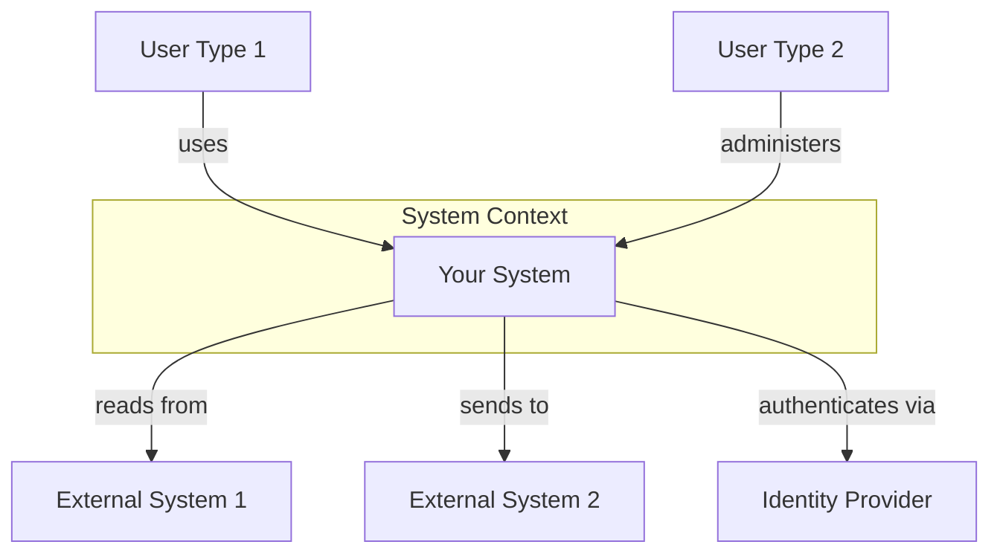
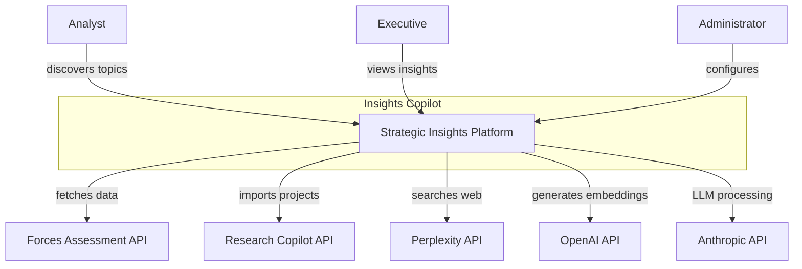
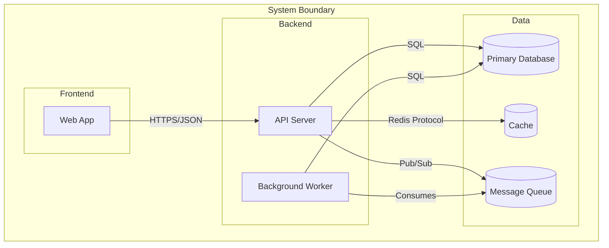
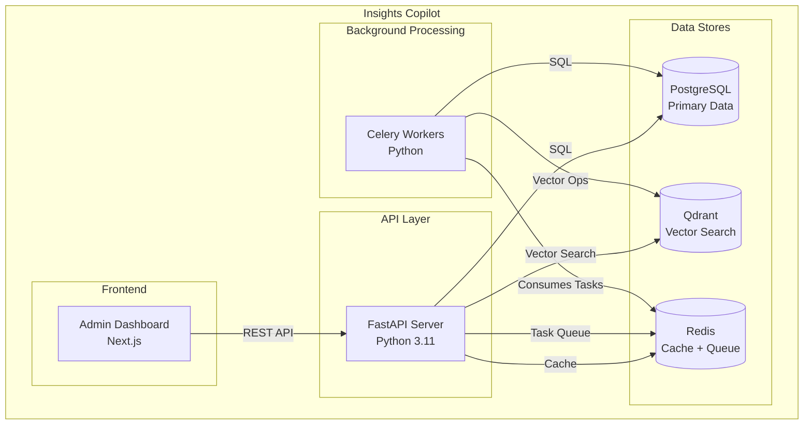
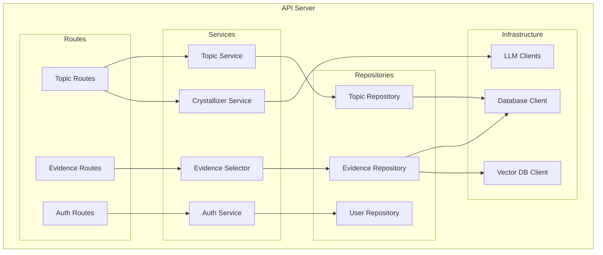
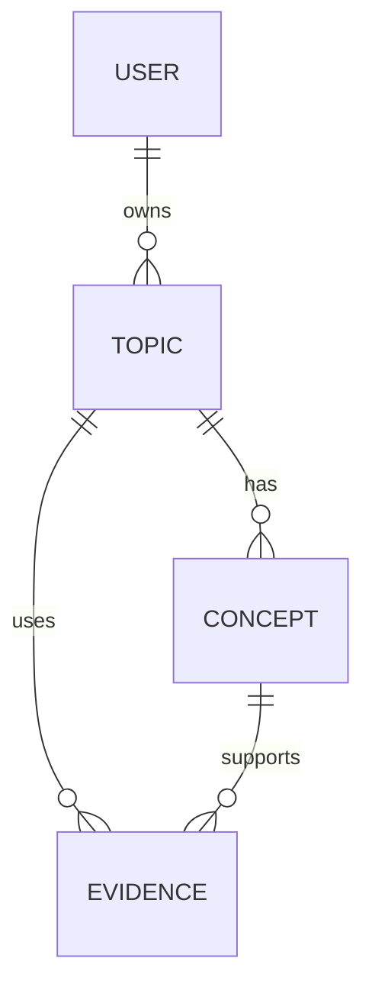
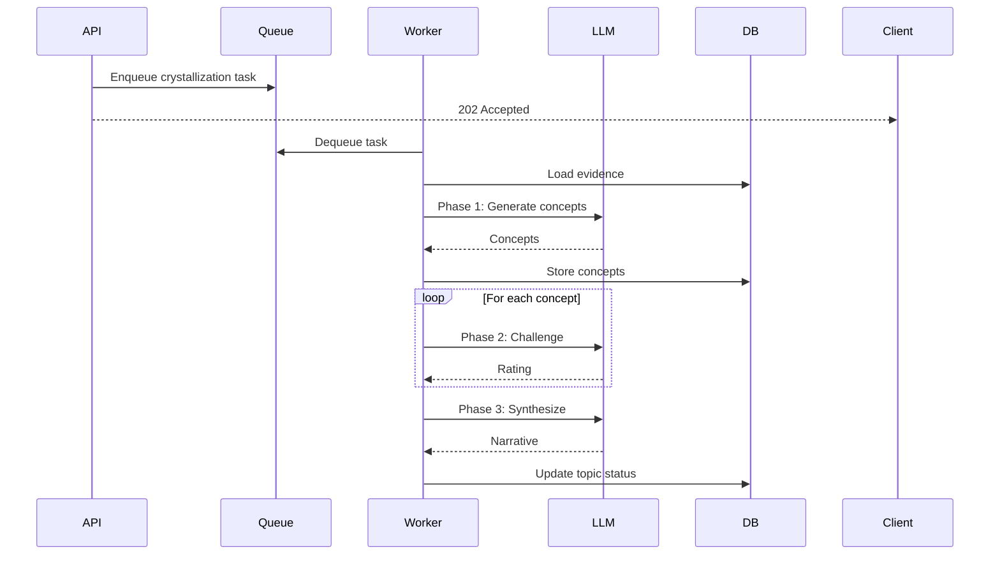

# Architecture Documentation Skill

Document software architecture effectively: system diagrams, component documentation, C4 models, and architectural views for different audiences.

---

## Core Principles

### Documentation Levels (C4 Model)

| Level | Name | Audience | Shows |
|-------|------|----------|-------|
| **1** | System Context | Executives, stakeholders | System + external actors |
| **2** | Container | Developers, architects | Applications, databases, services |
| **3** | Component | Developers | Components within containers |
| **4** | Code | Developers (optional) | Classes, interfaces |

### Key Tenets

1. **Multiple views for multiple audiences**: Executives need different docs than developers
2. **Decisions over descriptions**: Explain why, not just what
3. **Diagrams + text**: Neither alone is sufficient
4. **Keep it current**: Outdated architecture docs are worse than none
5. **Progressive detail**: Start high-level, drill down as needed

---


## Define Done

- [ ] Documentation answers the reader's most likely questions
- [ ] Structure follows a logical flow (concept → usage → reference)
- [ ] Code examples are tested and runnable
- [ ] Kept in sync with the code it documents

## System Context Diagram (Level 1)

### Purpose

Show the system and its relationships with users and external systems.

### Template



### Example: Insights Copilot



### Text Companion

Always pair diagrams with explanatory text:

```markdown
## System Context

Insights Copilot is a strategic intelligence platform that synthesizes
insights from multiple data sources.

### Users

| User | Description | Key Actions |
|------|-------------|-------------|
| Analyst | Strategic researcher | Discover topics, curate evidence |
| Executive | Decision maker | View crystallized insights |
| Administrator | System manager | Configure integrations, manage users |

### External Systems

| System | Integration | Data Flow |
|--------|-------------|-----------|
| Forces Assessment | REST API | Import assessment responses |
| Research Copilot | REST API | Import research findings |
| Perplexity | REST API | Web search results |
| OpenAI | REST API | Embedding generation |
| Anthropic | REST API | LLM processing |
```

---

## Container Diagram (Level 2)

### Purpose

Show the high-level technical building blocks: applications, data stores, and how they communicate.

### Template



### Example: Insights Copilot Containers



### Container Documentation Template

```markdown
## Containers

### Admin Dashboard

| Attribute | Value |
|-----------|-------|
| Technology | Next.js 14 |
| Repository | `admin-app/` |
| Deployment | Vercel |
| Purpose | Topic management, evidence curation, insights viewing |

### API Server

| Attribute | Value |
|-----------|-------|
| Technology | FastAPI, Python 3.11 |
| Repository | `api/` |
| Deployment | Docker on Hetzner |
| Purpose | REST API, business logic, orchestration |

### Data Stores

| Store | Technology | Purpose |
|-------|------------|---------|
| PostgreSQL | v15 | Primary data (topics, evidence, users) |
| Qdrant | v1.7 | Vector embeddings for semantic search |
| Redis | v7 | Caching, Celery task queue |
```

---

## Component Diagram (Level 3)

### Purpose

Show internal components within a container and their relationships.

### Example: API Server Components



### Component Documentation Template

```markdown
## API Server Components

### Service Layer

| Component | Purpose | Dependencies |
|-----------|---------|--------------|
| TopicService | Topic CRUD, discovery | TopicRepository |
| EvidenceSelector | Relevance-based evidence selection | EvidenceRepository, VectorDB |
| CrystallizerService | Three-phase topic crystallization | LLMClients, EvidenceSelector |
| AuthService | Authentication, authorization | UserRepository, JWT |

### Key Interfaces

```python
class TopicService:
    async def create_topic(self, data: TopicCreate) -> Topic
    async def discover_topics(self, params: DiscoveryParams) -> list[Topic]
    async def crystallize_topic(self, topic_id: str) -> CrystallizedTopic

class EvidenceSelector:
    async def select_for_topic(self, topic_id: str, max_results: int) -> list[Evidence]
    async def rank_by_relevance(self, query: str, evidence: list[Evidence]) -> list[Evidence]
```
```

---

## Architectural Views

### 4+1 View Model

| View | Stakeholder | Documents |
|------|-------------|-----------|
| **Logical** | Designers | Classes, packages, relationships |
| **Process** | Integrators | Concurrency, synchronization |
| **Development** | Programmers | Module organization, build |
| **Physical** | System engineers | Deployment topology |
| **Scenarios** | All | Use cases that tie views together |

### Logical View Example

```markdown
## Domain Model

### Core Entities

```
Topic
├── id: UUID
├── title: string
├── status: TopicStatus
├── concepts: Concept[]
└── evidence: Evidence[]

Evidence
├── id: UUID
├── source_type: SourceType
├── content: string
├── relevance_score: float
└── is_pinned: boolean

Concept
├── id: UUID
├── title: string
├── definition: string
└── evidence_strength: float
```

### Entity Relationships


```

### Process View Example

```markdown
## Topic Crystallization Process

### Sequence



### Concurrency Model

| Component | Model | Rationale |
|-----------|-------|-----------|
| API | Async (asyncio) | Handle many concurrent requests |
| Workers | Process pool | CPU-bound LLM processing |
| Database | Connection pool | Limit concurrent connections |
```

### Deployment View Example

```markdown
## Deployment Topology

### Production Environment

```
┌─────────────────────────────────────────────────────────┐
│                     Cloudflare CDN                       │
└───────────────────────────┬─────────────────────────────┘
                            │
┌───────────────────────────▼─────────────────────────────┐
│                    Vercel Edge                           │
│  ┌─────────────────────────────────────────────────┐    │
│  │           Admin Dashboard (Next.js)              │    │
│  └─────────────────────────────────────────────────┘    │
└───────────────────────────┬─────────────────────────────┘
                            │ HTTPS
┌───────────────────────────▼─────────────────────────────┐
│                    Hetzner VPS                           │
│  ┌──────────────┐  ┌──────────────┐  ┌──────────────┐   │
│  │   API (x2)   │  │ Worker (x3)  │  │   Nginx      │   │
│  │   Docker     │  │   Docker     │  │   Proxy      │   │
│  └──────┬───────┘  └──────┬───────┘  └──────────────┘   │
│         │                 │                              │
│  ┌──────▼─────────────────▼──────┐                      │
│  │         Docker Network         │                      │
│  └──────┬─────────────────┬──────┘                      │
│         │                 │                              │
│  ┌──────▼───────┐  ┌──────▼───────┐  ┌──────────────┐   │
│  │  PostgreSQL  │  │    Redis     │  │   Qdrant     │   │
│  │   (Docker)   │  │   (Docker)   │  │   (Docker)   │   │
│  └──────────────┘  └──────────────┘  └──────────────┘   │
└─────────────────────────────────────────────────────────┘
```

### Resource Requirements

| Service | CPU | Memory | Storage |
|---------|-----|--------|---------|
| API | 1 core | 1 GB | - |
| Worker | 2 cores | 2 GB | - |
| PostgreSQL | 2 cores | 4 GB | 50 GB SSD |
| Qdrant | 2 cores | 4 GB | 20 GB SSD |
| Redis | 0.5 core | 1 GB | 1 GB |
```

---

## Architecture Decision Records (ADRs)

### When to Write

- Database selection
- Framework/library choices
- Architectural patterns
- Integration approaches
- Security decisions

### ADR Template (MADR Format)

```markdown
# ADR-NNN: Title

## Status

Proposed | Accepted | Deprecated | Superseded by ADR-XXX

## Context

What problem are we solving? What constraints exist?

## Decision

What is the change we're proposing?

## Consequences

### Positive
- Benefit 1
- Benefit 2

### Negative
- Drawback 1
- Drawback 2

### Neutral
- Side effect 1

## Alternatives Considered

### Option A
- Pros: ...
- Cons: ...
- Rejected because: ...

### Option B
- Pros: ...
- Cons: ...
- Rejected because: ...
```

---

## Documentation Structure

### Recommended Directory Layout

```
docs/
├── architecture/
│   ├── README.md              # Architecture overview
│   ├── system-context.md      # Level 1 diagram
│   ├── containers.md          # Level 2 diagram
│   ├── components/            # Level 3 diagrams
│   │   ├── api-server.md
│   │   └── worker.md
│   ├── views/
│   │   ├── logical.md
│   │   ├── process.md
│   │   ├── deployment.md
│   │   └── data.md
│   └── decisions/             # ADRs
│       ├── 001-database.md
│       ├── 002-vector-db.md
│       └── 003-llm-provider.md
├── api/                       # API documentation
├── guides/                    # How-to guides
└── tutorials/                 # Learning tutorials
```

---

## Anti-Patterns

| Anti-Pattern | Problem | Solution |
|--------------|---------|----------|
| **Diagrams only** | No context or explanation | Always pair with text |
| **Monolithic doc** | Hard to maintain, find info | Split by view/level |
| **Stale architecture** | Misleads developers | Update with code changes |
| **Too detailed** | Information overload | Use progressive disclosure |
| **No decisions** | Why questions unanswered | Write ADRs |
| **PowerPoint trap** | Outdated, not version controlled | Use text-based diagrams |

---

## Tools

| Tool | Use Case |
|------|----------|
| **Mermaid** | Diagrams in markdown (version control friendly) |
| **PlantUML** | Complex UML diagrams |
| **Structurizr** | C4 model diagrams |
| **Draw.io** | Visual diagrams (export to Git) |
| **Excalidraw** | Whiteboard-style diagrams |

---

## Checklist

Before publishing architecture documentation:

- [ ] System context diagram shows all external actors
- [ ] Container diagram shows all major technical components
- [ ] Component diagrams exist for complex containers
- [ ] Deployment view shows production topology
- [ ] ADRs document key decisions
- [ ] Diagrams are text-based (version control)
- [ ] Text explains diagrams (not redundant)
- [ ] Different audiences have appropriate views
- [ ] Documentation is current with code

---

This skill enables clear, multi-level architecture documentation that serves different audiences effectively.


## Quality Tests

### Accuracy Test
- All code examples and commands actually work
- **PASS:** Copy-pasting any code block produces the described result
- **FAIL:** Examples are outdated or have syntax errors

### Findability Test
- Readers can find what they need within 30 seconds
- **PASS:** Clear headings, table of contents, and search-friendly terms
- **FAIL:** Important information buried in paragraphs without clear headings

