# Diagram Creation Skill

Create clear, maintainable technical diagrams using text-based tools like Mermaid and PlantUML. Diagrams that live in version control with your code.

---

## Core Principles

### Why Text-Based Diagrams

| Benefit | Description |
|---------|-------------|
| **Version control** | Track changes, review in PRs |
| **Maintenance** | Edit text, not drag-and-drop |
| **Consistency** | Same styling across diagrams |
| **Automation** | Generate from code/data |
| **Portability** | Render in GitHub, GitLab, docs sites |

### Diagram Selection Guide

| Diagram Type | Use When |
|--------------|----------|
| **Flowchart** | Decision logic, processes |
| **Sequence** | Time-ordered interactions |
| **Class/ER** | Data structures, relationships |
| **State** | State machines, lifecycles |
| **Architecture** | System components, deployment |
| **Gantt** | Timelines, schedules |

---


## Define Done

- [ ] Documentation answers the reader's most likely questions
- [ ] Structure follows a logical flow (concept → usage → reference)
- [ ] Code examples are tested and runnable
- [ ] Kept in sync with the code it documents

## Mermaid Diagrams

### Flowcharts

```markdown
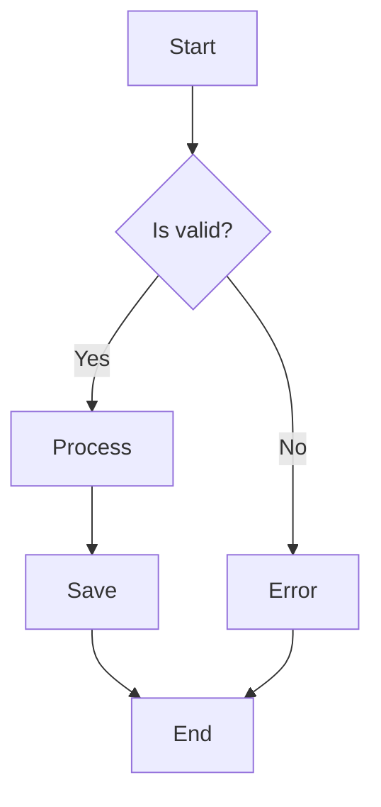
```

**Rendered:**


**Node Shapes:**

| Shape | Syntax | Use For |
|-------|--------|---------|
| Rectangle | `[text]` | Process/action |
| Rounded | `(text)` | Start/end |
| Diamond | `{text}` | Decision |
| Circle | `((text))` | Connector |
| Parallelogram | `[/text/]` | Input/output |

**Direction:**
- `TD` = Top to Down
- `LR` = Left to Right
- `BT` = Bottom to Top
- `RL` = Right to Left

### Sequence Diagrams

```markdown
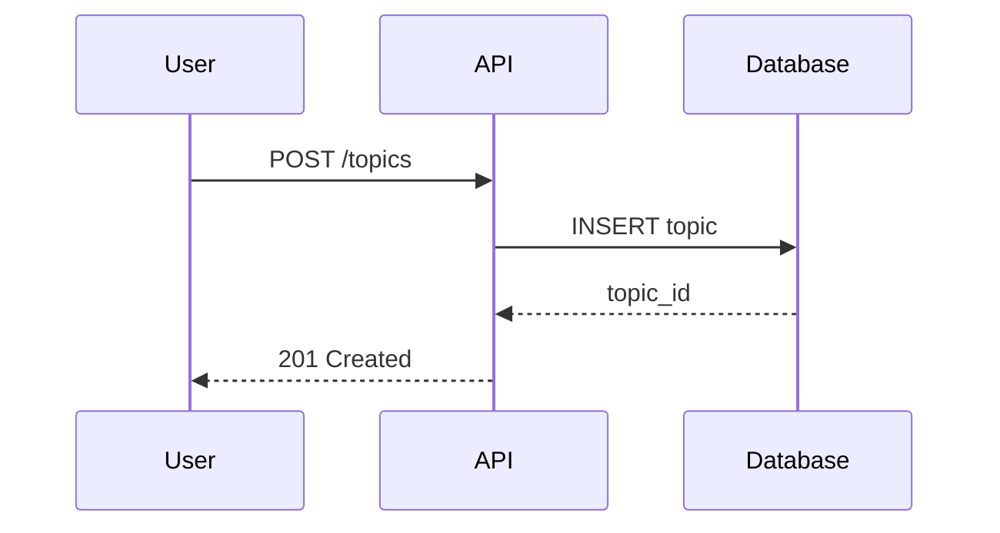
```

**Arrow Types:**

| Arrow | Syntax | Meaning |
|-------|--------|---------|
| Solid line | `->` | Sync call |
| Dashed line | `-->` | Response |
| Solid arrow | `->>` | Async call |
| Dashed arrow | `-->>` | Async response |

**Advanced Features:**

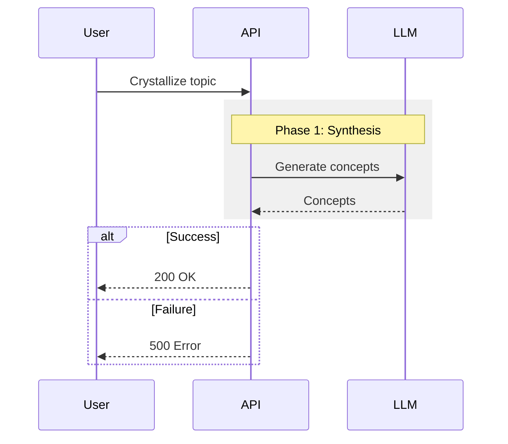

### Class Diagrams

```markdown
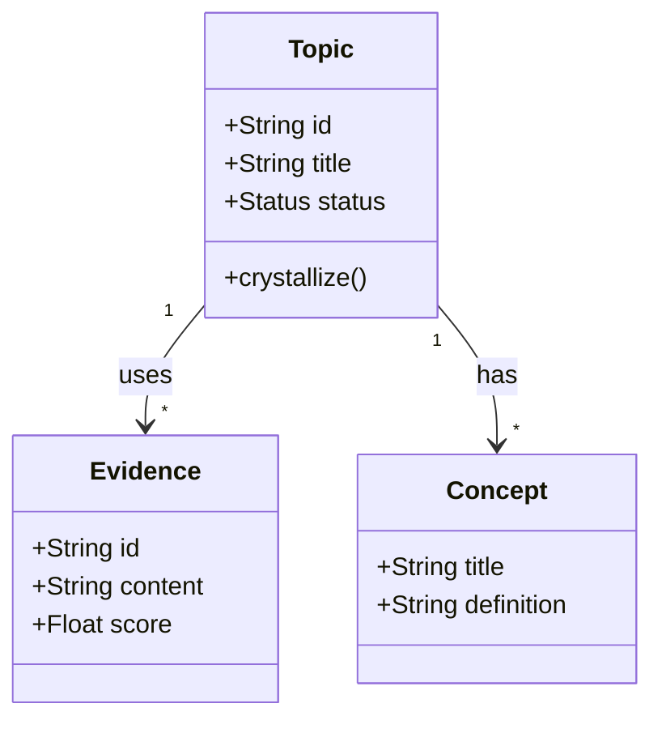
```

### Entity Relationship Diagrams

```markdown
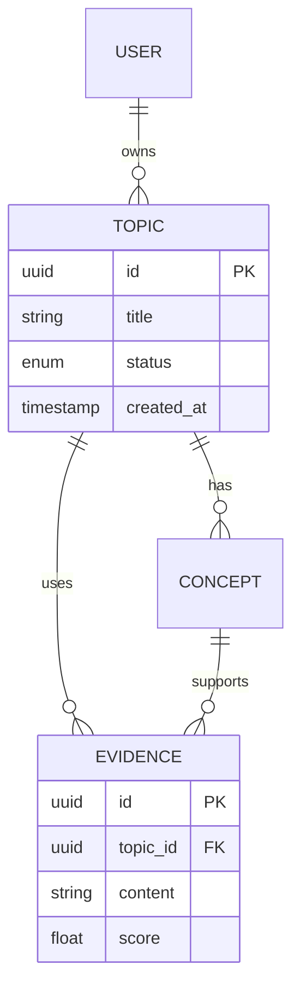
```

### State Diagrams

```markdown
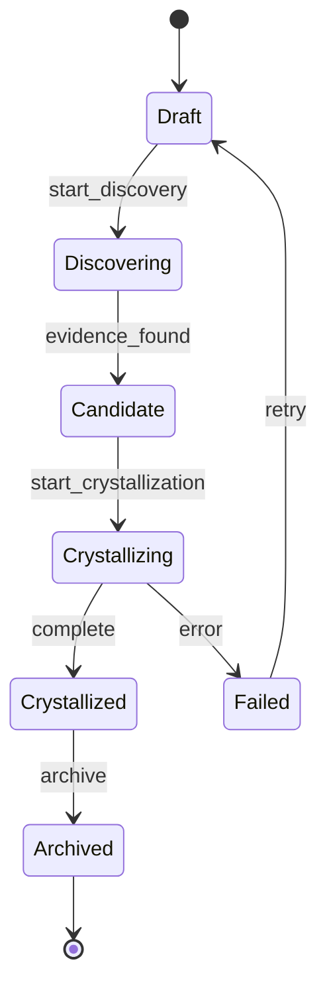
```

### Architecture Diagrams

```markdown
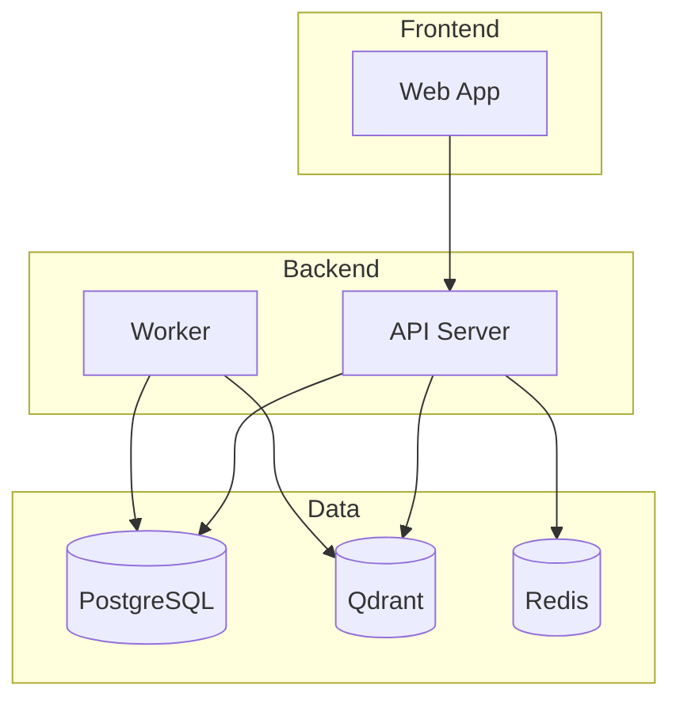
```

### Gantt Charts

```markdown
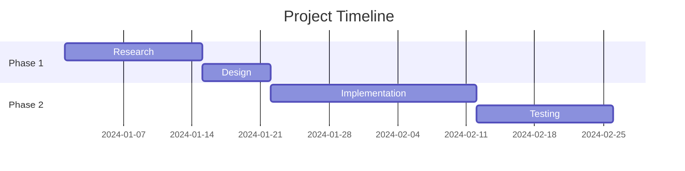
```

---

## PlantUML

### When to Use PlantUML

- More complex UML diagrams
- Enterprise architecture (C4, ArchiMate)
- Precise control over layout
- Batch diagram generation

### Sequence Diagram

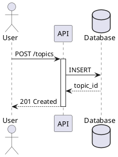

### Component Diagram

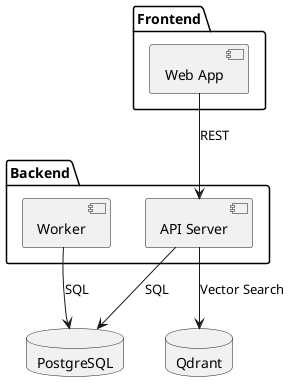

### C4 Diagrams

```plantuml
@startuml
!include https://raw.githubusercontent.com/plantuml-stdlib/C4-PlantUML/master/C4_Container.puml

Person(user, "Analyst", "Strategic researcher")
System_Boundary(system, "Insights Copilot") {
    Container(web, "Web App", "Next.js", "Admin interface")
    Container(api, "API", "FastAPI", "Business logic")
    ContainerDb(db, "Database", "PostgreSQL", "Primary data")
    ContainerDb(vector, "Vector DB", "Qdrant", "Embeddings")
}

Rel(user, web, "Uses", "HTTPS")
Rel(web, api, "Calls", "REST")
Rel(api, db, "Reads/writes", "SQL")
Rel(api, vector, "Searches", "gRPC")
@enduml
```

---

## ASCII Diagrams

### When to Use ASCII

- Terminal/CLI documentation
- Environments without Mermaid support
- Inline code comments
- Maximum portability

### Box Drawing

```
┌─────────────┐     ┌─────────────┐
│   Client    │────▶│    API      │
└─────────────┘     └──────┬──────┘
                           │
                    ┌──────▼──────┐
                    │  Database   │
                    └─────────────┘
```

### Flow Diagram

```
Input ──▶ Validate ──▶ Process ──▶ Output
              │
              ▼
           Error
```

### Box Characters

```
Single line: ─ │ ┌ ┐ └ ┘ ├ ┤ ┬ ┴ ┼
Double line: ═ ║ ╔ ╗ ╚ ╝ ╠ ╣ ╦ ╩ ╬
Arrows:      ▶ ◀ ▲ ▼ → ← ↑ ↓
```

---

## Diagram Best Practices

### Keep It Simple

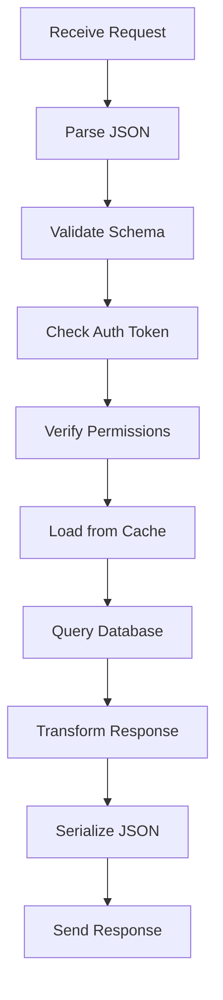

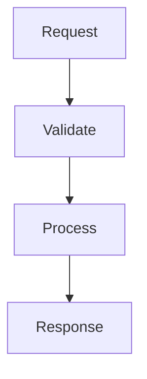

### Use Subgraphs for Grouping

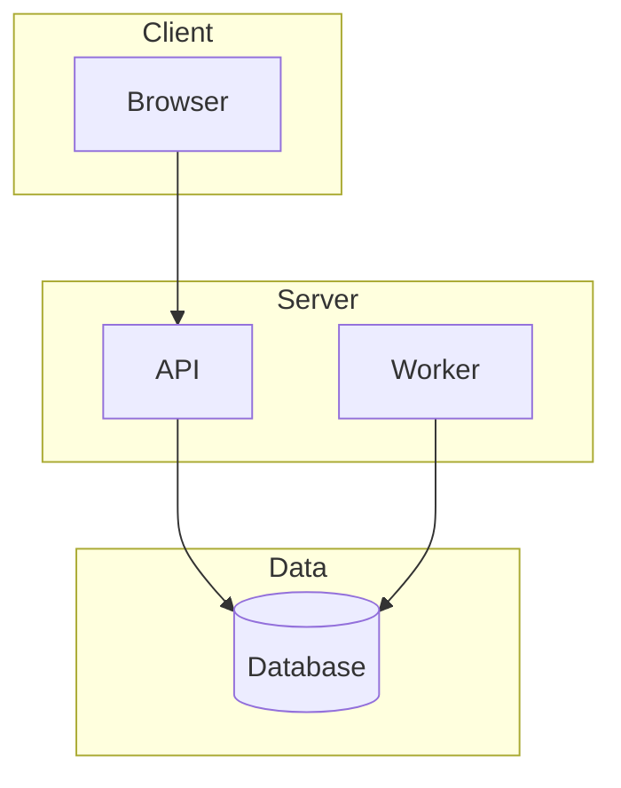

### Consistent Styling

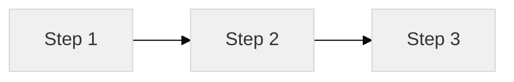

### Add Context

Always accompany diagrams with explanatory text:

```markdown
## System Architecture

The system consists of three main components:

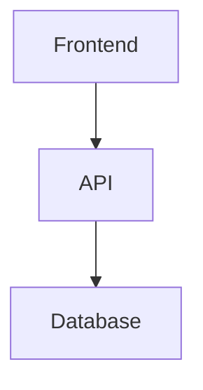

- **Frontend**: Next.js application serving the admin interface
- **API**: FastAPI server handling business logic
- **Database**: PostgreSQL storing topics, evidence, and users
```

---

## Common Diagram Patterns

### Request/Response Flow

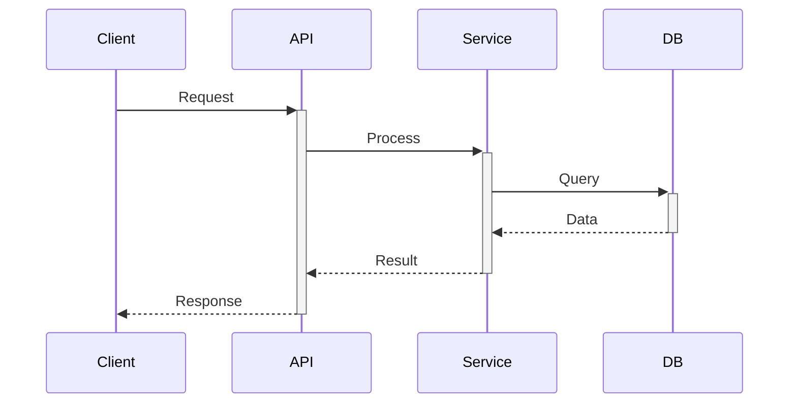

### Error Handling Flow

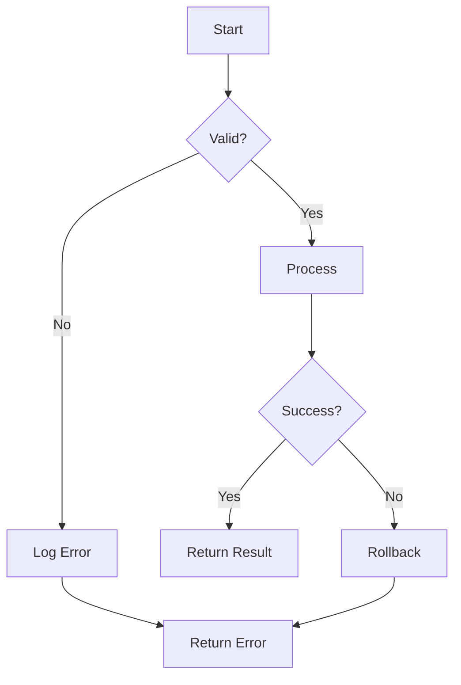

### State Machine

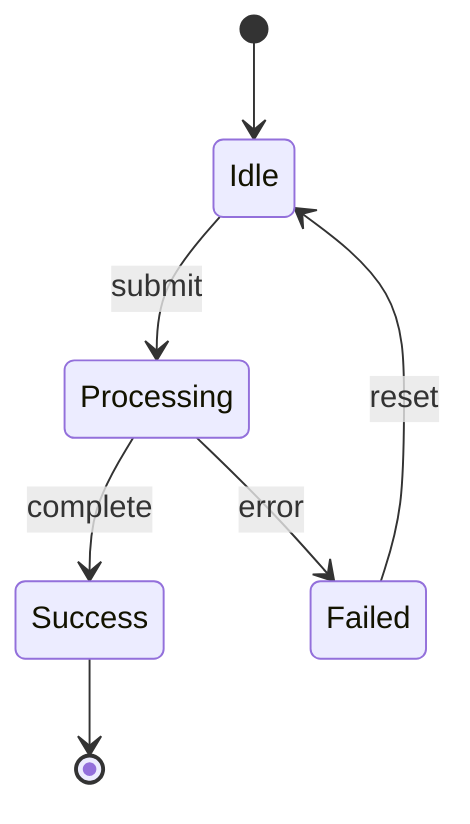

### Deployment Topology

```mermaid
graph TB
    subgraph Cloud
        LB[Load Balancer]
        subgraph App Tier
            A1[API 1]
            A2[API 2]
        end
        subgraph Data Tier
            DB[(Primary DB)]
            DBR[(Replica)]
        end
    end

    LB --> A1
    LB --> A2
    A1 --> DB
    A2 --> DB
    DB --> DBR
```

---

## Tools and Rendering

### Mermaid Support

| Platform | Support |
|----------|---------|
| GitHub | Native in markdown |
| GitLab | Native in markdown |
| Notion | Via embed |
| VS Code | With extension |
| Docusaurus | Native plugin |
| MkDocs | With plugin |

### PlantUML Support

| Tool | Usage |
|------|-------|
| PlantUML Server | Self-host or public |
| VS Code | With extension |
| IntelliJ | Built-in |
| Confluence | Plugin available |

### Export Options

- PNG: For documentation, presentations
- SVG: For scalable web embedding
- PDF: For print materials

---

## Anti-Patterns

| Anti-Pattern | Problem | Solution |
|--------------|---------|----------|
| **Too detailed** | Overwhelming, unreadable | Show key steps only |
| **No legend** | Unclear what shapes mean | Add explanatory text |
| **Outdated** | Misleads readers | Update with code changes |
| **Image-only** | Can't edit, version | Use text-based format |
| **Inconsistent** | Confusing across docs | Use style guide |
| **No context** | Diagram alone is ambiguous | Add explanatory paragraphs |

---

## Checklist

Before publishing diagrams:

- [ ] Diagram type matches content (flow for process, sequence for interactions)
- [ ] Key components labeled clearly
- [ ] Not overly detailed (can understand in 30 seconds)
- [ ] Accompanied by explanatory text
- [ ] Uses consistent styling
- [ ] Text-based format (Mermaid/PlantUML)
- [ ] Renders correctly in target platform
- [ ] Accessible (alt text if image export)

---

This skill enables clear, maintainable technical diagrams that enhance documentation and live alongside your code.


## Quality Tests

### Accuracy Test
- All code examples and commands actually work
- **PASS:** Copy-pasting any code block produces the described result
- **FAIL:** Examples are outdated or have syntax errors

### Findability Test
- Readers can find what they need within 30 seconds
- **PASS:** Clear headings, table of contents, and search-friendly terms
- **FAIL:** Important information buried in paragraphs without clear headings

